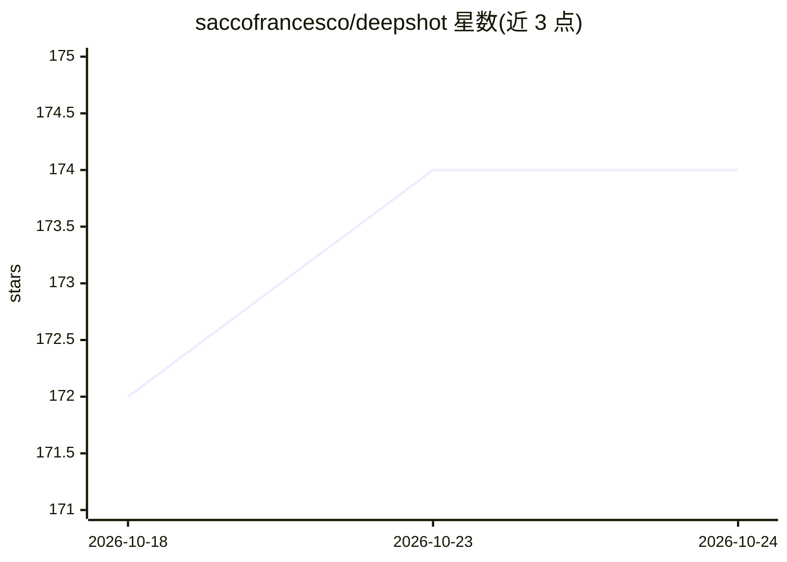

# saccofrancesco/deepshot

⭐ 174 · Jupyter Notebook · MIT · 推送 2026-10-23 · [GitHub](https://github.com/saccofrancesco/deepshot) · 个人维护

**基于机器学习与滚动统计的 NBA 比赛胜负预测应用**

DeepShot 是一个用机器学习预测 NBA 比赛结果的应用：从 Basketball Reference 抓取真实历史数据，用 EWMA（指数加权移动平均）等滚动统计特征刻画球队近期状态，经模型训练后预测对阵胜负，并以 NiceGUI 网页界面可视化展示比赛与关键统计差异。数据全部来自免费公开来源，支持 Windows/macOS/Linux 本地运行。使用需先 git clone 并安装依赖，再运行 model.ipynb 训练生成 deepshot.pkl 模型文件，最后 python main.py 启动网页应用。

## 筛选速览

| 维度 | 判定 | 备注 |
|---|---|---|
| AI 角色 | `ai-native` | 本体是模型或模型工具 |
| 许可风险 | `permissive` | MIT |
| 部署形态 | `library` | 以包/库形式分发 |
| 模型依赖 | — | README 未给出锁定关系 |
| 硬件要求 | — | 无带数字的原话,不猜 |
| 安装摩擦 | `low` | 无编译、无系统依赖或容器化 |
| 成熟度 | — | 结构信号不足 |

## 能力要点

- EWMA 滚动统计特征刻画球队近期状态
- NiceGUI 网页界面展示预测与关键统计差异
- 数据来自 Basketball Reference 免费公开来源
- 跨平台本地运行（Windows/macOS/Linux）

## 适用场景

- 预测 NBA 对阵胜负并查看依据的统计差异
- 本地跑通一个从数据抓取到预测展示的完整 ML 流程
- 了解滚动统计特征在体育预测中的用法

## 场景标签

 · 领域:体育数据分析

## 证据(README 行号)

> L23: DeepShot is a machine learning-based NBA game predictor using advanced rolling stats (like EWMA) and real historica
> L33: * **Data-Driven Predictions** – Powered by real NBA stats from Basketball Reference.

## 星数曲线

2026-10-18 172 → 2026-10-24 174（+2）

---
*卡片 v1 · prompt 1.4 · 生成 2026-10-22 · 置信度 mid · 依据 README sha `765e4fc4bc75` · [字段定义](../../DATASET.md)*
