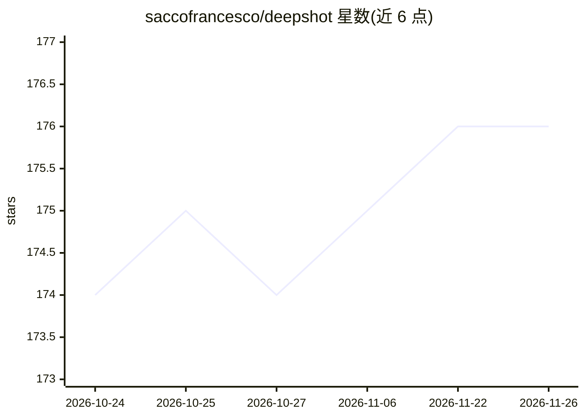

# saccofrancesco/deepshot

⭐ 176 · Jupyter Notebook · MIT · 推送 2026-11-25 · [GitHub](https://github.com/saccofrancesco/deepshot) · 个人维护

**面向 NBA 爱好者的机器学习比赛胜负预测工具**

基于 Basketball Reference 历史数据的 NBA 比赛结果预测工具，使用指数加权移动平均（EWMA）等滚动统计特征训练机器学习模型，通过 Jupyter notebook 训练生成模型文件，以 NiceGUI 构建的本地 Web 界面展示对阵预测与两队关键统计差异。依赖免费公开数据，支持 Windows/macOS/Linux 本地运行；模型需用户先运行 notebook 训练生成。

## 筛选速览

| 维度 | 判定 | 备注 |
|---|---|---|
| AI 角色 | `ai-native` | 本体是模型或模型工具 |
| 许可风险 | `permissive` | MIT |
| 部署形态 | `library` | 以包/库形式分发 |
| 模型依赖 | — | README 未给出锁定关系 |
| 硬件要求 | — | 无带数字的原话,不猜 |
| 安装摩擦 | `low` | 无编译、无系统依赖或容器化 |
| 成熟度 | — | 结构信号不足 |

## 能力要点

- 基于 EWMA 滚动统计的特征工程捕捉近期状态与势头
- NiceGUI 实时 Web 界面可视化对阵与预测结果
- 自动高亮两队关键统计差异
- 完全基于公开免费数据（Basketball Reference）

## 适用场景

- 预测 NBA 对阵的胜负结果
- 可视化对比两支球队的近期统计趋势
- 学习体育比赛预测的特征工程与模型评估流程

## 场景标签

`模型评测` `数据分析` · 领域:效率与自动化

## 证据(README 行号)

> L25: DeepShot is a machine learning-based NBA game predictor using advanced rolling stats (like EWMA) and real historica
> L35: * **Data-Driven Predictions** – Powered by real NBA stats from Basketball Reference.

## 星数曲线

2026-10-24 174 → 2026-11-26 176（+2）

---
*卡片 v1 · prompt 1.4 · 生成 2026-11-26 · 置信度 high · 依据 README sha `d48e2f06bdc8` · [字段定义](../../DATASET.md)*
