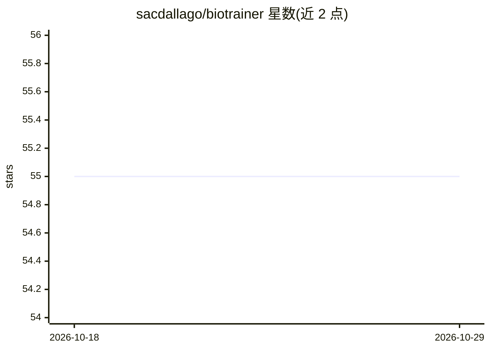

# sacdallago/biotrainer

⭐ 55 · Python · MIT · 推送 2026-10-21 · [GitHub](https://github.com/sacdallago/biotrainer) · [官网](https://biocentral.cloud/app) · 个人维护

**蛋白质机器学习框架：简化蛋白质预测模型训练与评测**

面向蛋白质分析的开源机器学习框架，提供训练与推理流水线，支持残基级/序列级的分类与回归协议。内建蛋白质语言模型嵌入（ProtT5、ESM-2、ESM-C 等）及 blosum62、one_hot 等基线；BioEngineer 模块支持零样本预测与突变序列生成；AutoEval 模块可在精选下游任务上自动评测蛋白质语言模型并对比公开结果。通过 pip 安装并提供 Docker 预构建镜像；自带 CLI 已标记 deprecated，官方建议使用 Biocentral 提供的界面。

## 筛选速览

| 维度 | 判定 | 备注 |
|---|---|---|
| AI 角色 | `ai-native` | 本体是模型或模型工具 |
| 许可风险 | `permissive` | MIT |
| 部署形态 | `self-host` | docker 或自建部署 |
| 模型依赖 | — | README 未给出锁定关系 |
| 硬件要求 | — | 无带数字的原话,不猜 |
| 安装摩擦 | `low` | 无编译、无系统依赖或容器化 |
| 成熟度 | — | 结构信号不足 |

## 能力要点

- 残基级/序列级分类与回归六种训练协议
- 内建 ProtT5/ESM-2/ESM-C 等蛋白质语言模型嵌入
- BioEngineer 零样本预测与突变序列生成
- AutoEval 自动评测蛋白质语言模型并提供公开结果看板

## 适用场景

- 训练蛋白质亚细胞定位、二级结构等预测模型
- 生成并比较蛋白质语言模型的嵌入表示
- 在下游基准任务上自动评测蛋白质语言模型

## 场景标签

`模型训练` `模型评测` · 领域:评测与运维

## 证据(README 行号)

> L13: *Biotrainer* is an open-source framework that simplifies machine learning model development for protein analysis.
> L16: - **Training**: Easy to use training and inference pipelines for protein feature prediction
> L17: - **Embedding**: Built-in support for protein language models (ProtT5, ESM-2, ESM-C, ...) and baselines (blosum62,

## 星数曲线

2026-10-18 55 → 2026-10-29 55（+0）

---
*卡片 v1 · prompt 1.4 · 生成 2026-10-24 · 置信度 high · 依据 README sha `3634ebde9281` · [字段定义](../../DATASET.md)*
