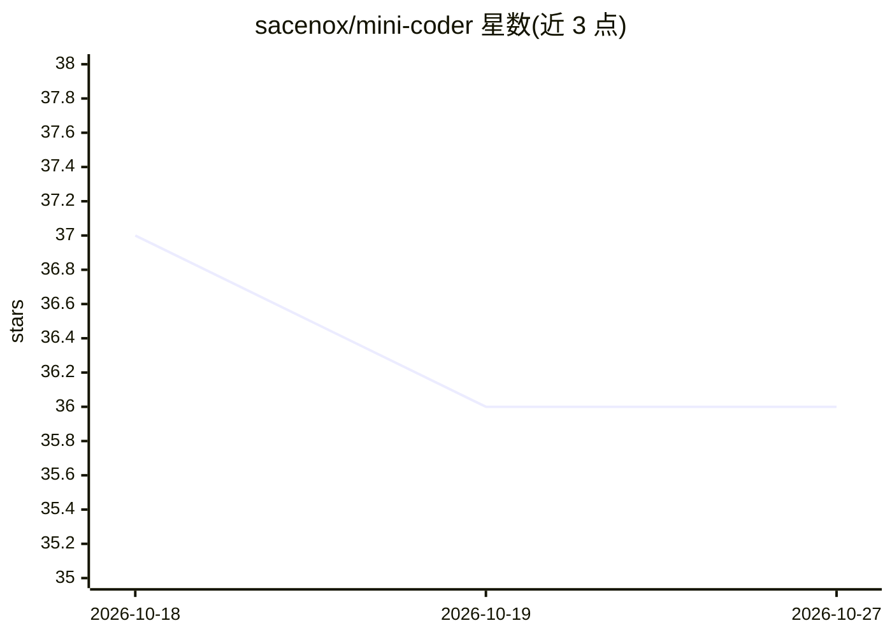

# sacenox/mini-coder

⭐ 36 · TypeScript · 推送 2026-10-02 · [GitHub](https://github.com/sacenox/mini-coder) · [官网](https://sacenox.github.io/mini-coder/) · 个人维护

**极简终端编码 agent：可控模型输入、可视模型行为**

终端 TUI 编码 agent，通过 edit/read/bash 工具让模型执行代码修改，强调对发送给模型内容的控制与模型行为的可见性，bash 编辑时渲染当前工作目录内的 diff。模型经 pi-ai 目录配置，支持四种 wire API（openai-completions/responses、anthropic-messages、google-generative-ai）接入托管或自托管模型，API key 从环境解析。会话以 append-only JSONL 记录，支持 SKILL.md 技能目录与 AGENTS.md/CLAUDE.md 追加到系统提示。工具参数在边界校验。npm 全局安装。

## 筛选速览

| 维度 | 判定 | 备注 |
|---|---|---|
| AI 角色 | `ai-native` | 本体是模型或模型工具 |
| 许可风险 | `none` | — |
| 部署形态 | `library` | 以包/库形式分发 |
| 模型依赖 | — | README 未给出锁定关系 |
| 硬件要求 | — | 无带数字的原话,不猜 |
| 安装摩擦 | `low` | 无编译、无系统依赖或容器化 |
| 成熟度 | — | 结构信号不足 |

## 能力要点

- 四种 wire API 支持托管与本地自托管模型等同接入
- edit/read/bash 工具，参数在边界校验
- SKILL.md 技能目录与 AGENTS.md/CLAUDE.md 自动追加系统提示
- 会话以 append-only JSONL 文件记录

## 适用场景

- 在终端里让 agent 直接读写文件并执行命令完成编码任务
- 审计发送给模型的内容并追踪其改动（diff 渲染）
- 接入自托管或非默认模型作为编码后端

## 场景标签

`编码 Agent` · 领域:编码与开发

## 证据(README 行号)

> L5: Minimalistic terminal coding agent, with an emphasis on giving you control of what is sent to
> L6: the model, and visibility into the model's actions.
> L41: - `provider` / `model` — any model from the `pi-ai` catalog. Requires a discoverable api key

## 星数曲线

2026-10-18 37 → 2026-10-27 36（-1）

---
*卡片 v1 · prompt 1.4 · 生成 2026-10-25 · 置信度 high · 依据 README sha `939af511fbfd` · [字段定义](../../DATASET.md)*
