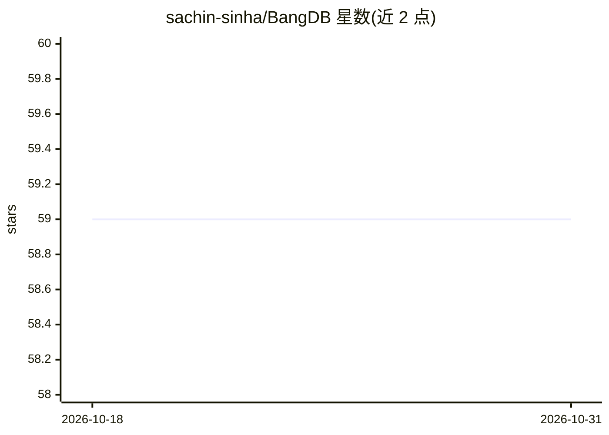

# sachin-sinha/BangDB

⭐ 59 · Shell · 推送 2026-08-15 · [GitHub](https://github.com/sachin-sinha/BangDB) · [官网](http://bangdb.com) · 个人维护

**面向开发者/企业的融合 NoSQL 数据库，含流处理与机器学习**

C/C++ 编写的 NoSQL 数据库，支持键值、文档、列、时序与大对象存储，内建流处理（过滤、join、聚合、CEP、滑动窗口、UDF）与图查询（Cypher 变体）。AI 部分提供机器学习、信息抽取（IE）与流上训练预测；深度学习仅在 Enterprise Edition 提供。提供嵌入式、Server 两种运行形态（P2P 分布式为 upcoming），安装方式含官网下载、tar 包、git clone 与 Docker 镜像，运行 install.sh 安装依赖（java8、python3 等）。给需要一体化存储+流+AI 能力的开发者与企业使用。

## 筛选速览

| 维度 | 判定 | 备注 |
|---|---|---|
| AI 角色 | `ai-enhanced` | 去掉 AI 部分产品仍成立 |
| 许可风险 | `none` | — |
| 部署形态 | `None` |  |
| 模型依赖 | — | README 未给出锁定关系 |
| 硬件要求 | — | 无带数字的原话,不猜 |
| 安装摩擦 | `medium` | 含编译或系统依赖之一 |
| 成熟度 | `idea` | |

## 能力要点

- 多模型 NoSQL：键值/文档/列/时序/BRS 大对象
- 内建流处理：过滤、join、聚合、CEP、滑动窗口、UDF
- 图查询支持 Cypher 变体与本体（IE 信息抽取）
- 流上训练与预测（bangdb_ml_helper）；DL 仅限 Enterprise Edition

## 适用场景

- IoT 车辆监控数据的实时入库与分析
- 流式数据上的复杂事件处理与预测
- 欺诈检测、供应链管理等实时分析场景
- 嵌入式部署到树莓派等微处理器设备

## 场景标签

 · 领域:数据库/实时分析

## 证据(README 行号)

> L49: * AI
> L52: 	* DL (Deep Learning - with Enterprise Edition only)

## 星数曲线

2026-10-18 59 → 2026-10-31 59（+0）

---
*卡片 v1 · prompt 1.4 · 生成 2026-10-24 · 置信度 high · 依据 README sha `71520130e124` · [字段定义](../../DATASET.md)*
