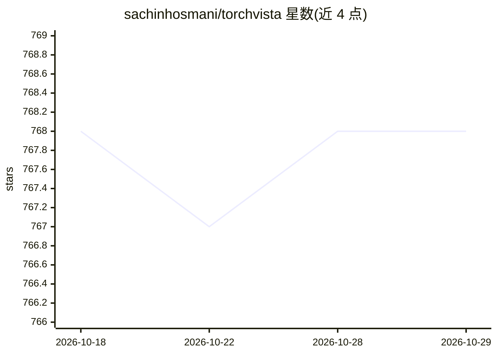

# sachinhosmani/torchvista

⭐ 768 · Python · GPL-3.0 · 推送 2026-09-05 · [GitHub](https://github.com/sachinhosmani/torchvista) · [官网](https://sachinhosmani.github.io/torchvista/) · 个人维护

**给 PyTorch 开发者的 notebook 前向传播交互可视化工具**

在 Jupyter、Google Colab、Kaggle 等 web notebook 中以一行代码可视化 PyTorch 模型的前向传播图。提供可拖拽缩放的交互图、层级模块的可折叠节点、点击查看参数与属性信息，并在形状不匹配等错误发生时输出容错的部分可视化以辅助调试。核心 API 为 trace_model，支持导出 png/svg/html，含实验性的重复节点压缩视图（仅识别 Sequential 与 ModuleList 内的重复节点，大模型上开销可能较大）。通过 pip 或 conda-forge 安装。

## 筛选速览

| 维度 | 判定 | 备注 |
|---|---|---|
| AI 角色 | `ai-ecosystem` | LLM/agent 周边工具 |
| 许可风险 | `viral` | GPL-3.0 |
| 部署形态 | `library` | 以包/库形式分发 |
| 模型依赖 | — | README 未给出锁定关系 |
| 硬件要求 | — | 无带数字的原话,不猜 |
| 安装摩擦 | `low` | 无编译、无系统依赖或容器化 |
| 成熟度 | `idea` | |

## 能力要点

- 一行代码在 notebook 中可视化 PyTorch 前向传播
- 交互图支持拖拽缩放、节点折叠与参数/属性查看
- 出错时（如形状不匹配）提供容错的部分可视化
- 可导出为 png、svg、html 格式

## 适用场景

- 调试模型结构错误（如形状不匹配）
- 理解与讲解模型的层级结构
- 导出模型结构图用于文档或报告

## 场景标签

 · 领域:深度学习工具/可视化

## 证据(README 行号)

> L3: An interactive tool to visualize the forward pass of a PyTorch model directly in the notebook—with a single line of 
> L30: pip install torchvista

## 星数曲线

2026-10-18 768 → 2026-10-29 768（+0）

---
*卡片 v1 · prompt 1.4 · 生成 2026-10-21 · 置信度 high · 依据 README sha `7dae112be481` · [字段定义](../../DATASET.md)*
