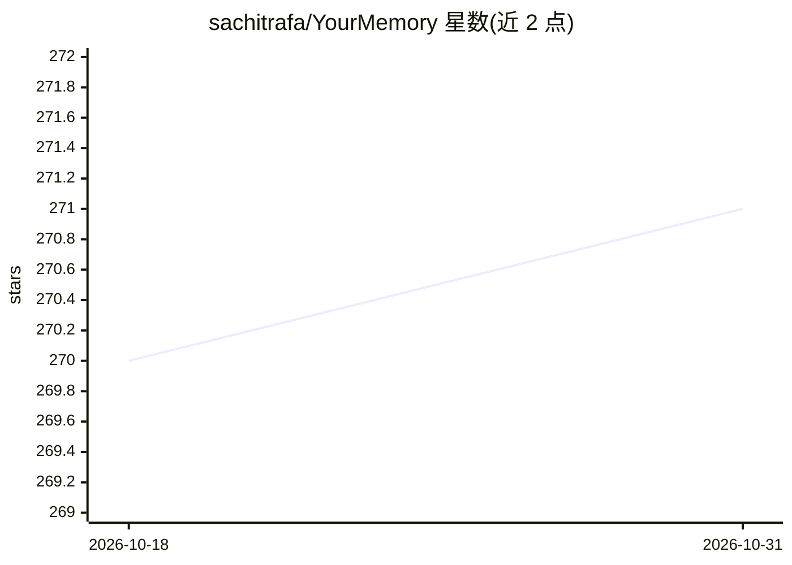

# sachitrafa/YourMemory

⭐ 271 · Python · NOASSERTION · 推送 2026-09-19 · [GitHub](https://github.com/sachitrafa/YourMemory) · [官网](https://yourmemoryai.xyz/) · 个人维护

**为 AI agent 提供持久化记忆的 MCP 服务器，含遗忘曲线衰减**

面向 AI agent 的持久记忆系统，以 MCP 服务器形式接入 Claude Code、Cursor、Cline、Windsurf 等 MCP 客户端。核心机制：从对话抽取事实后做主体感知去重、嵌入与实体图链接；相关事实累积后压缩为摘要（整合）；记忆按 Ebbinghaus 遗忘曲线衰减，按类别设定半衰期，低于阈值自动修剪；检索采用向量+BM25+图扩展混合两轮排序。另提供哈希链审计日志、团队共享记忆池、数据导出/清除端点与两个内置浏览器 UI。默认 DuckDB 本地存储，可选 Postgres+pgvector；安装需注册获取 token（CC BY-NC 4.0 许可）。

## 筛选速览

| 维度 | 判定 | 备注 |
|---|---|---|
| AI 角色 | `ai-ecosystem` | LLM/agent 周边工具 |
| 许可风险 | `none` | NOASSERTION |
| 部署形态 | `desktop` | 安装包/桌面程序 |
| 模型依赖 | local-ok | 支持本地模型 |
| 硬件要求 | — | 无带数字的原话,不猜 |
| 安装摩擦 | `low` | 无编译、无系统依赖或容器化 |
| 成熟度 | — | 结构信号不足 |

## 能力要点

- 记忆按 Ebbinghaus 遗忘曲线衰减，分类别半衰期与强度修剪
- 事实整合（N→1 摘要压缩）与主体感知去重
- 向量+BM25+实体图两轮混合检索
- 哈希链防篡改审计日志与团队记忆池、数据导出/清除端点

## 适用场景

- 让 Claude/Cursor 等编码 agent 跨会话记住偏好与项目上下文
- 团队多个 agent 共享记忆池并保留私有记忆
- 需要审计与合规控制（导出/遗忘权）的 agent 记忆存储

## 场景标签

`Agent 记忆` · 领域:Agent 开发

## 证据(README 行号)

> L47: |🔌|**MCP-native & local-first**|Works with Claude, Cursor, Cline, Windsurf, or any MCP client. Runs entirely on you
> L254: ## 🔧 MCP Tools
> L260: |`recall_memory(query, current_path?)`|Start of every task|Surfaces memories ranked by similarity × decay strength

## 星数曲线

2026-10-18 270 → 2026-10-31 271（+1）

---
*卡片 v1 · prompt 1.4 · 生成 2026-10-22 · 置信度 high · 依据 README sha `608f8b1c0a98` · [字段定义](../../DATASET.md)*
