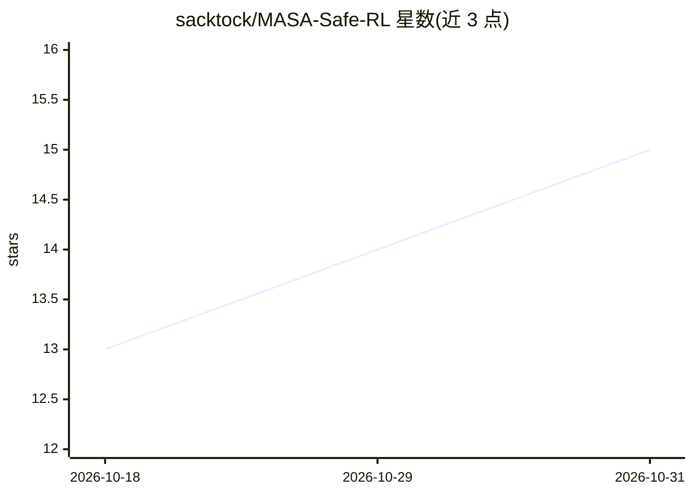

# sacktock/MASA-Safe-RL

⭐ 15 · Jupyter Notebook · Apache-2.0 · 推送 2026-10-30 · [GitHub](https://github.com/sacktock/MASA-Safe-RL) · [官网](https://sacktock.github.io/MASA-Safe-RL/) · 组织维护

**安全强化学习研究库：统一约束与环境接口**

面向多智能体与单智能体安全强化学习（Safe RL）研究的 Python 库，基于 Gymnasium 接口构建，覆盖 CMDP、概率约束、Reach-Avoid 与 LTL-Safety（DFA）等属性，并依赖 JAX 提供 GPU 加速。当前提供一组表格型安全 RL 算法，以及模块化可复用的算法与约束开发框架，附带 CLI（如 masa run）与示例。处于早期开发阶段，维护者来自帝国理工学院，Apache 2.0 许可。

## 筛选速览

| 维度 | 判定 | 备注 |
|---|---|---|
| AI 角色 | `ai-native` | 本体是模型或模型工具 |
| 许可风险 | `permissive` | Apache-2.0 |
| 部署形态 | `library` | 以包/库形式分发 |
| 模型依赖 | — | README 未给出锁定关系 |
| 硬件要求 | — | 无带数字的原话,不猜 |
| 安装摩擦 | `medium` | 含编译或系统依赖之一 |
| 成熟度 | `idea` | |

## 能力要点

- 基于 Gymnasium 接口的统一约束与环境 API
- 覆盖 CMDP、概率约束、Reach-Avoid、LTL-Safety(DFA)
- 预置 CLI 与示例（masa run / masa example）
- JAX GPU 加速支持（CUDA 12/13 可选依赖组）

## 适用场景

- 在统一接口下对比不同约束类型的安全 RL 算法
- 开发更复杂的安全 RL 算法与约束形式
- 在论文研究中复用并可引用的安全 RL 基准环境

## 场景标签

 · 领域:强化学习/AI 研究工具

## 证据(README 行号)

> L7: Welcome to MASA-Safe-RL, the Multi and Single Agent (MASA) Safe Reinforcement Learning library. The primary goal of 
> L9: The library is in very early stage development and we greatly appreciate and encourage feedback from the community a

## 星数曲线

2026-10-18 13 → 2026-10-31 15（+2）

---
*卡片 v1 · prompt 1.4 · 生成 2026-10-31 · 置信度 high · 依据 README sha `700fe4c386d2` · [字段定义](../../DATASET.md)*
