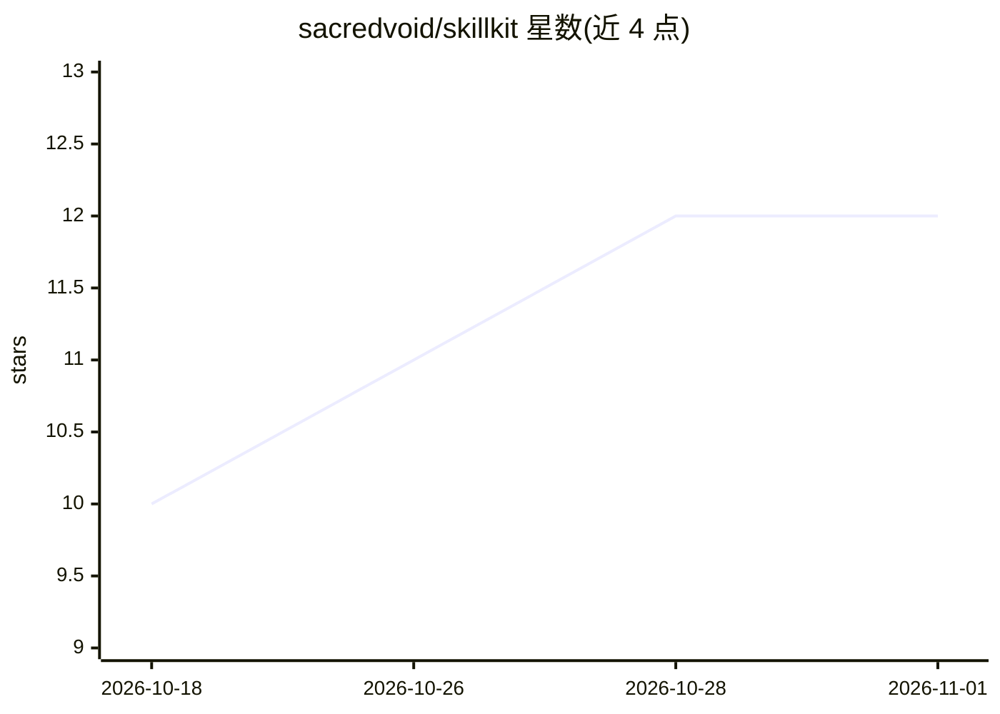

# sacredvoid/skillkit

⭐ 12 · JavaScript · MIT · 推送 2026-03-18 · [GitHub](https://github.com/sacredvoid/skillkit) · 个人维护

**面向 AI 编程助手的技能合集：图像、演示文稿、视频处理等 9 项**

以独立 SKILL.md 文件形式提供的 AI 编程技能集合，共 9 项技能，覆盖图像搜索、SVG 品牌标识生成、单文件 HTML 演示文稿、Whisper 本地转录与 ffmpeg 抽帧、本地 Stable Diffusion 图像生成、生成艺术、落地页构建与 Raycast 扩展脚手架等。技能可安装到 Claude Code（插件或复制文件），或转换为 Cursor/Windsurf/Copilot/Cline/Continue/Aider/Zed 等工具的规则格式使用。各技能依赖不一，如视频处理需 ffmpeg 与 Python，本地图像生成需 Python 与 PyTorch。

## 筛选速览

| 维度 | 判定 | 备注 |
|---|---|---|
| AI 角色 | `ai-knowledge` | 知识聚合/清单类 |
| 许可风险 | `permissive` | MIT |
| 部署形态 | `library` | 以包/库形式分发 |
| 模型依赖 | — | README 未给出锁定关系 |
| 硬件要求 | — | 无带数字的原话,不猜 |
| 安装摩擦 | `medium` | 含编译或系统依赖之一 |
| 成熟度 | — | 结构信号不足 |

## 能力要点

- 9 项技能均为独立 SKILL.md，可移植到多种 AI 编程助手
- 本地 Whisper 转录按硬件自动选择 faster-whisper/openai-whisper
- 本地 Stable Diffusion 生成，检测 Apple Silicon/CUDA/ROCm/CPU 并推荐模型
- Logo 生成输出 3 个 SVG 变体、7 个 favicon 及 PWA manifest 等完整品牌套件

## 适用场景

- 在 Claude Code 中通过插件方式调用图像生成、演示文稿制作等技能
- 把技能文件转成 Cursor/Windsurf/Copilot 的规则在现有工具中使用
- 用本地模型做录音转写与图像生成，避免 API 依赖

## 场景标签

`代码生成` `图像生成` `语音识别` `图像视频处理` · 领域:编码与开发

## 证据(README 行号)

> L5: A curated collection of AI coding skills for creative and productivity workflows. Each skill is a standalone markdow
> L77: Each skill is a standalone markdown file. Copy the `SKILL.md` into your tool's instruction/rule format:

## 星数曲线

2026-10-18 10 → 2026-11-01 12（+2）

---
*卡片 v1 · prompt 1.4 · 生成 2026-11-01 · 置信度 mid · 依据 README sha `f81c8676ee5a` · [字段定义](../../DATASET.md)*
