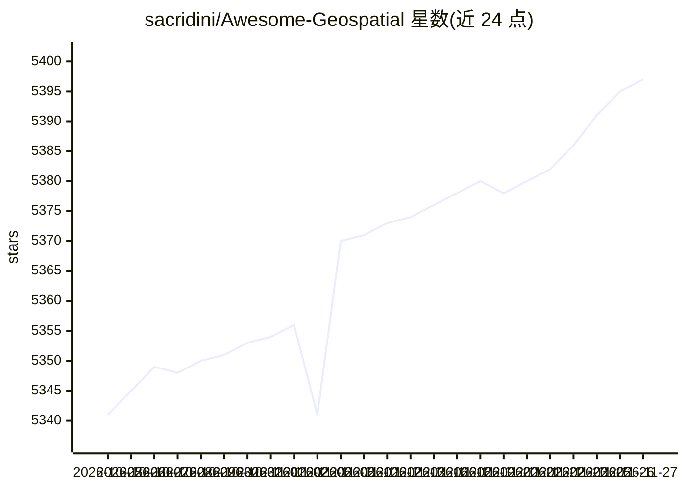

# sacridini/Awesome-Geospatial

⭐ 5,397 · CC0-1.0 · 推送 2026-11-18 · [GitHub](https://github.com/sacridini/Awesome-Geospatial) · 个人维护

**面向 GIS 从业者的地理空间分析工具策展清单**

以 awesome-list 形式收录地理空间分析工具与资源，按数据库、影像分类与数字图像处理、GIS 桌面软件、Web 地图开发等类别组织，条目涵盖商业软件、开源库、空间扩展与可视化框架，每个条目附一句功能说明。清单本身不提供安装步骤或教程，定位为工具发现目录；维护者持续扩充条目，收录范围横跨遥测、摄影测量、矢量瓦片与时空数据库等方向。

## 筛选速览

| 维度 | 判定 | 备注 |
|---|---|---|
| AI 角色 | `ai-knowledge` | 知识聚合/清单类 |
| 许可风险 | `viral` | CC0-1.0 |
| 部署形态 | `library` | 以包/库形式分发 |
| 模型依赖 | — | README 未给出锁定关系 |
| 硬件要求 | — | 无带数字的原话,不猜 |
| 安装摩擦 | `medium` | 含编译或系统依赖之一 |
| 成熟度 | — | 结构信号不足 |

## 能力要点

- 按 Database / Image Classification / GIS / Web Map Development 等类别组织条目
- 同时收录商业软件（ArcGIS、ENVI）与开源项目（QGIS、PostGIS、Leaflet）
- 覆盖空间数据库扩展、摄影测量、WebGL 地图可视化等多方向

## 适用场景

- 为 GIS 项目查找合适的空间数据库或扩展
- 调研遥感影像处理与摄影测量软件选项
- 寻找 Web 端地图渲染与可视化库

## 场景标签

`精选清单` · 领域:学习与行业

## 证据(README 行号)

> L3: Long list of geospatial analysis tools. Geospatial analysis, or just spatial analysis, is an approach to applying st
> L11: ## Database
> L102: ## Web Map Development

## 星数曲线

2026-10-25 5,341 → 2026-11-27 5,397（+56）

---
*卡片 v1 · prompt 1.4 · 生成 2026-11-22 · 置信度 mid · 依据 README sha `10cb7cb4794b` · [字段定义](../../DATASET.md)*
