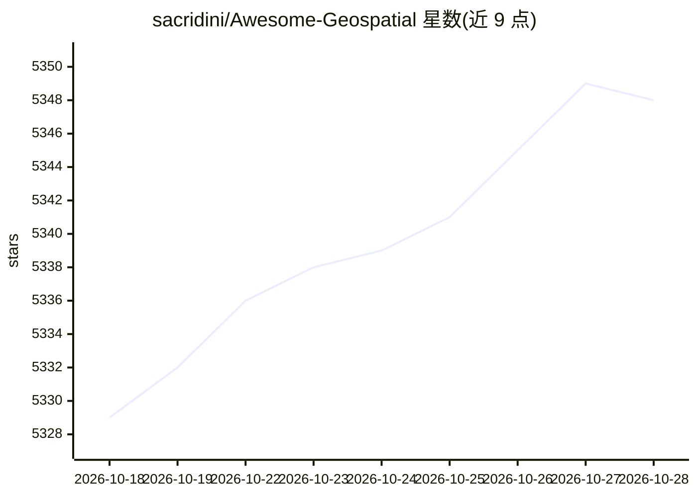

# sacridini/Awesome-Geospatial

⭐ 5,350 · CC0-1.0 · 推送 2026-10-17 · [GitHub](https://github.com/sacridini/Awesome-Geospatial) · 个人维护

**地理空间分析工具长清单：收录 GIS/遥感/制图资源**

Awesome 风格的地理空间工具聚合清单，按数据库、图像分类与数字摄影测量、地理信息系统、Web 地图开发等类别组织条目，收录 PostGIS、QGIS、GRASS GIS、Leaflet、MapLibre GL 等数据库扩展、桌面 GIS 软件与 Web 制图库，每条附一句话简介。面向需要查找与选型地理空间工具的开发者与科研用户。README 为条目列举形式，不提供安装或运行机制。

## 筛选速览

| 维度 | 判定 | 备注 |
|---|---|---|
| AI 角色 | `ai-knowledge` | 知识聚合/清单类 |
| 许可风险 | `viral` | CC0-1.0 |
| 部署形态 | `None` |  |
| 模型依赖 | — | README 未给出锁定关系 |
| 硬件要求 | — | 无带数字的原话,不猜 |
| 安装摩擦 | `medium` | 含编译或系统依赖之一 |
| 成熟度 | — | 结构信号不足 |

## 能力要点

- 按数据库/GIS/图像处理/Web 制图等类别组织的长清单
- 覆盖开源与商业地理空间工具并各附一句话简介
- 条目包含空间数据库扩展、桌面 GIS 与 Web 制图 JavaScript 库

## 适用场景

- 为 GIS 项目查找空间数据库扩展与桌面软件
- 寻找 Web 地图开发用的 JavaScript 库
- 比较遥感图像处理与摄影测量软件选项

## 场景标签

`精选清单` · 领域:学习与行业

## 证据(README 行号)

> L1: # Awesome Geospatial Awesome
> L3: Long list of geospatial analysis tools. Geospatial analysis, or just spatial analysis, is an approach to applying st

## 星数曲线

2026-10-18 5,329 → 2026-10-28 5,348（+19）

---
*卡片 v1 · prompt 1.4 · 生成 2026-10-20 · 置信度 high · 依据 README sha `91b7dff22c23` · [字段定义](../../DATASET.md)*
