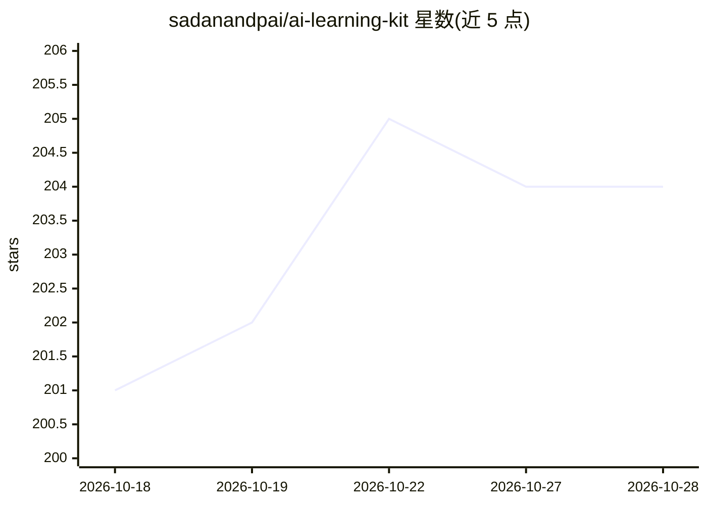

# sadanandpai/ai-learning-kit

⭐ 204 · MIT · 推送 2026-08-02 · [GitHub](https://github.com/sadanandpai/ai-learning-kit) · 个人维护

**AI/ML 学习资源策展清单：路线图、课程、仓库与练习平台分类汇编**

一个按学习路径组织的 AI/ML 资源汇编：从数学基础、Python、机器学习、深度学习，到 LLM、Agentic AI、MLOps 与 AI 工程，覆盖学习路线图、免费/付费课程与书籍、学习仓库、练习题库、数据集平台与竞赛平台。条目以图标标注资源类型（路线图/书/视频/仓库/平台），可按需跳读而非按固定顺序使用。仓库以 MIT 许可发布，面向自学 AI/ML 与数据科学的学习者。

## 筛选速览

| 维度 | 判定 | 备注 |
|---|---|---|
| AI 角色 | `ai-knowledge` | 知识聚合/清单类 |
| 许可风险 | `permissive` | MIT |
| 部署形态 | `None` |  |
| 模型依赖 | — | README 未给出锁定关系 |
| 硬件要求 | — | 无带数字的原话,不猜 |
| 安装摩擦 | `low` | 无编译、无系统依赖或容器化 |
| 成熟度 | — | 结构信号不足 |

## 能力要点

- 覆盖数学→ML→DL→LLM/Agent→MLOps 的完整学习路径分类
- 以图标区分 7 种资源类型（路线图/书/视频/仓库/平台等）
- 收录 Microsoft 12 周 AI/ML/GenAI 系列课程等多个开源课程仓库
- 含练习题库、数据集平台与竞赛平台栏目

## 适用场景

- 按路线图系统自学 AI 工程或 ML 工程
- 查找 LLM、RAG、Agentic AI 方向的课程与教程仓库
- 寻找 NumPy/PyTorch 练习题与数据科学面试准备资源

## 场景标签

`教程课程` `精选清单` · 领域:学习与行业

## 证据(README 行号)

> L2:  A curated collection of AI learning materials
> L6: This is a curated toolkit, not a rigid curriculum. While structured in a logical sequence, feel free to jump to any 

## 星数曲线

2026-10-18 201 → 2026-10-28 204（+3）

---
*卡片 v1 · prompt 1.4 · 生成 2026-10-22 · 置信度 high · 依据 README sha `3fc1091ac6e9` · [字段定义](../../DATASET.md)*
