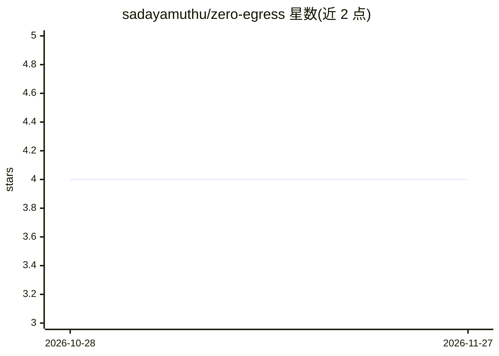

# sadayamuthu/zero-egress

⭐ 4 · TypeScript · Apache-2.0 · 推送 2026-11-11 · [GitHub](https://github.com/sadayamuthu/zero-egress) · 个人维护

**离线 AI 代码编辑器：聊天/代理/补全仅连本地模型**

基于 Electron 的 AI 代码编辑器，提供聊天、代理模式、后台代理、Quick Edit（Cmd+K）与自动补全，仅连接用户自建的模型服务器（Ollama、vLLM、LM Studio、oMLX）。移除遥测、自动更新、在线扩展市场、云登录，运行时守卫拦截并记录其他所有连接。代理模式的每次修改需人工审阅，后台代理在独立 git worktree 中工作，逐项接受变更。提供 macOS/Windows/Linux 安装包，首次运行自动探测本机回环地址上的模型服务。

## 筛选速览

| 维度 | 判定 | 备注 |
|---|---|---|
| AI 角色 | `ai-native` | 本体是模型或模型工具 |
| 许可风险 | `permissive` | Apache-2.0 |
| 部署形态 | `desktop` | 安装包/桌面程序 |
| 模型依赖 | local-ok | 支持本地模型 |
| 硬件要求 | — | 无带数字的原话,不猜 |
| 安装摩擦 | `low` | 无编译、无系统依赖或容器化 |
| 成熟度 | — | 结构信号不足 |

## 能力要点

- 仅连接用户配置的模型服务器，运行时守卫拦截其他出站连接并记录
- 代理模式编辑前先询问，所有变更以 diff 形式逐项接受/拒绝
- 后台代理在独立 git worktree 工作，支持并行多个代理
- 支持从 VS Code 或 Windsurf 迁移设置

## 适用场景

- 在无外网或涉密环境中使用 AI 辅助编码
- 代码与提示词不出本机的隐私敏感开发场景
- 在内网 GPU 服务器上运行模型、笔记本连接使用

## 场景标签

`编码 Agent` `代码生成` · 领域:编码与开发

## 证据(README 行号)

> L7: An AI code editor that works offline. ZeroEgress has chat, an agent mode,
> L12: marketplace, analytics and cloud sign-in are removed. A runtime guard
> L123:  For agent mode and background agents, use 14B or larger. The agent edits

## 星数曲线

2026-10-28 4 → 2026-11-27 4（+0）

---
*卡片 v1 · prompt 1.4 · 生成 2026-11-21 · 置信度 high · 依据 README sha `9baa46885ab9` · [字段定义](../../DATASET.md)*
