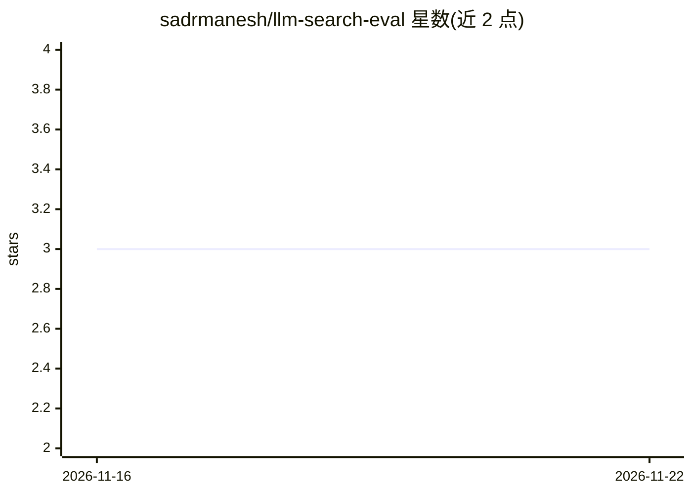

# sadrmanesh/llm-search-eval

⭐ 3 · Python · MIT · 推送 2026-11-19 · [GitHub](https://github.com/sadrmanesh/llm-search-eval) · [官网](https://sadrmanesh.github.io/llm-search-eval/) · 个人维护

**电商搜索质量评估库：IR 指标+LLM 评审团+CI 门禁**

面向发布排序变更的电商搜索团队：以 nDCG、precision/recall@k、MRR、MAP 等经典 IR 指标打分，用 LLM-as-judge 补足金标集缺口，支持多评委合议与一致性统计（Cohen/Fleiss kappa、Krippendorff's alpha）、按 token 计量并设成本预算、配对显著性检验比较系统，并输出自包含 HTML 仪表盘与 GitHub Action 质量门禁。支持波斯语与英语查询，零运行时依赖，Python 3.10–3.13。

## 筛选速览

| 维度 | 判定 | 备注 |
|---|---|---|
| AI 角色 | `ai-ecosystem` | LLM/agent 周边工具 |
| 许可风险 | `permissive` | MIT |
| 部署形态 | `self-host` | docker 或自建部署 |
| 模型依赖 | local-ok | 支持本地模型 |
| 硬件要求 | — | 无带数字的原话,不猜 |
| 安装摩擦 | `low` | 无编译、无系统依赖或容器化 |
| 成熟度 | — | 结构信号不足 |

## 能力要点

- LLM 评审团多数/均值/中位数等聚合方式及与金标的一致性校准
- 按 token/成本/判定数设预算，estimate 命令预测花费且超预算时退出码为 1
- 内容寻址判定缓存，重跑不重复付费；CI 可用确定性 mock judge
- 单文件 HTML 仪表盘与 GitHub Action 门禁在指标下滑时使构建失败

## 适用场景

- 比较 BM25、混合检索、重排序等新排序方案是否优于现状
- 在 CI 中阻止指标回归的排序变更合并
- 金标不足时用 LLM 评委补标并校验评委与人工的一致性
- 对波斯语-英语多语目录做搜索质量评估

## 场景标签

`模型评测` · 领域:评测与运维

## 证据(README 行号)

> L9: **Measure product search quality with classic IR metrics and panels of LLM relevance judges, compare systems with st
> L29: `llm-search-eval` merges your gold labels with LLM judgments for the gaps, can ask several judges and measure how m
> L42: - **Quality gates:** `llm-search-eval gate` and a reusable GitHub Action fail the build when a metric drops below a

## 星数曲线

2026-11-16 3 → 2026-11-22 3（+0）

---
*卡片 v1 · prompt 1.4 · 生成 2026-11-21 · 置信度 high · 依据 README sha `b18e12146165` · [字段定义](../../DATASET.md)*
