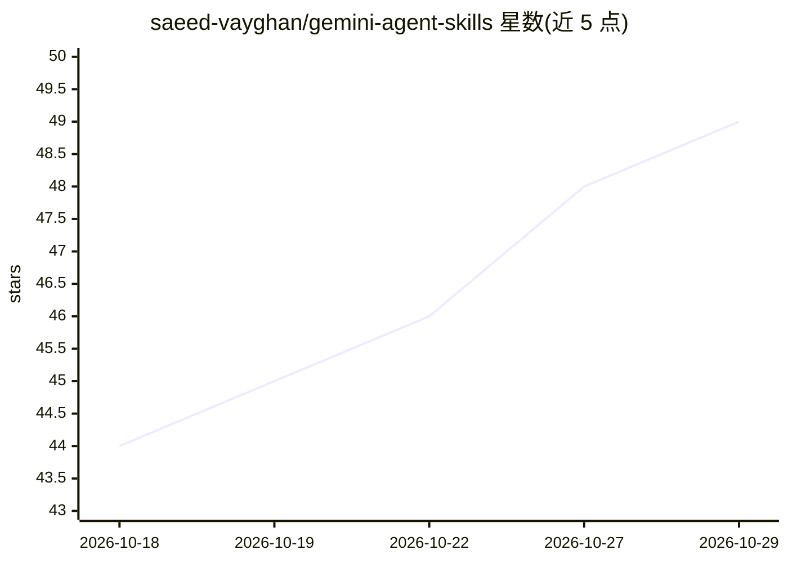

# saeed-vayghan/gemini-agent-skills

⭐ 49 · TypeScript · MIT · 推送 2026-01-18 · [GitHub](https://github.com/saeed-vayghan/gemini-agent-skills) · 个人维护

**面向 Gemini 的 agent 技能合集与 Claude 技能转换 CLI**

包含两部分：一组面向 Google Gemini 的专家 agent 技能（核心开发、语言专家、基础设施、质量安全、数据 AI、开发者体验、专业领域、商业产品、元编排共 9 类，含上百个技能定义，源自 VoltAgent 团队的 Claude Code subagents 集合并加以适配），以及一个 Node.js CLI，可把 Anthropic Claude Code 的 Plugins/Agents/Skills 配置转换为 Gemini Agent Skill 格式，转换过程调用 gemini-2.0-flash-exp API，需配置 GEMINI_API_KEY。使用者按需挑选技能或转换自有 Claude 提示词，在 Gemini CLI 中调用。

## 筛选速览

| 维度 | 判定 | 备注 |
|---|---|---|
| AI 角色 | `ai-knowledge` | 知识聚合/清单类 |
| 许可风险 | `permissive` | MIT |
| 部署形态 | `library` | 以包/库形式分发 |
| 模型依赖 | locked-api |  |
| 硬件要求 | — | 无带数字的原话,不猜 |
| 安装摩擦 | `medium` | 含编译或系统依赖之一 |
| 成熟度 | — | 结构信号不足 |

## 能力要点

- CLI 将 Claude Code 配置（Plugins/Agents/Skills）转换为 Gemini Skill 格式
- 两种转换模式：Plugin Mode（合并为单一 Skill）与 Agents Mode（批量独立转换）
- 9 大类别、上百个专家 agent 技能定义，按菜单式按需取用
- 转换过程使用 gemini-2.0-flash-exp API 并生成含 Persona/Workflow 注册表的 SKILL.md

## 适用场景

- 把已有的 Claude Code agents/plugins 迁移到 Gemini 生态使用
- 为 Gemini CLI 挑选特定领域（如 sql-pro、debugger）的专家技能
- 将自定义 Claude 提示词转换为 Gemini 可用的技能文件

## 场景标签

`提示工程` `精选清单` · 领域:Agent 开发

## 证据(README 行号)

> L2: A comprehensive collection of expert AI Agent Skills for Google Gemini.
> L6: A CLI tool to convert Anthropic Claude "Code" configurations (Plugins, Agents, Skills) into Google Gemini Agent Skil
> L130: ### 01. Core Development

## 星数曲线

2026-10-18 44 → 2026-10-29 49（+5）

---
*卡片 v1 · prompt 1.4 · 生成 2026-10-25 · 置信度 mid · 依据 README sha `04b457d5cf3c` · [字段定义](../../DATASET.md)*
