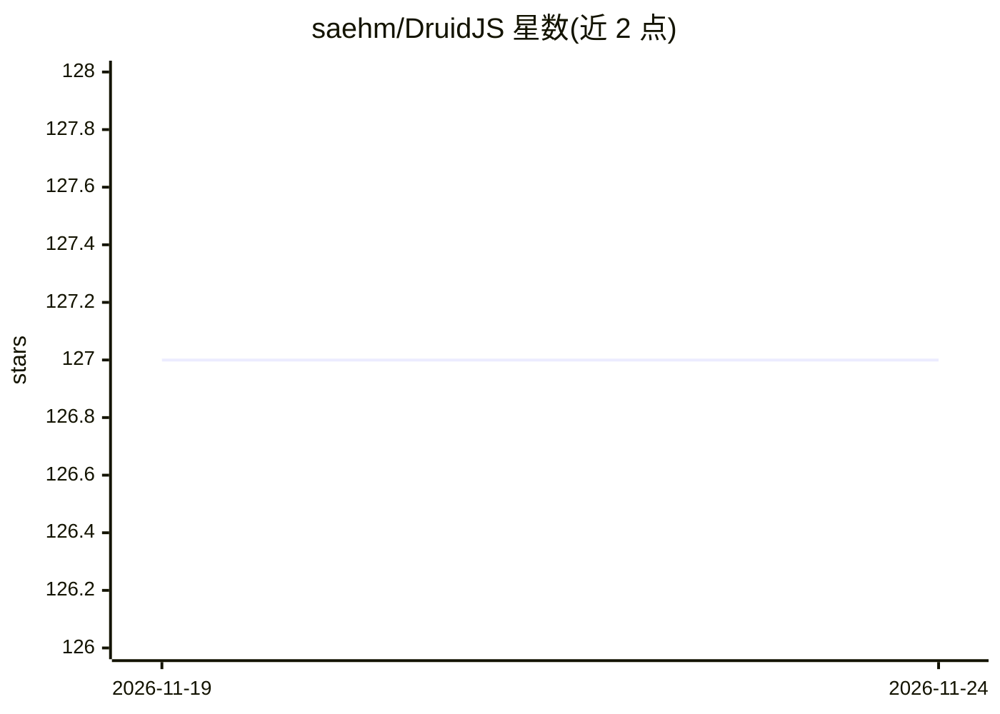

# saehm/DruidJS

⭐ 127 · JavaScript · LGPL-3.0 · 推送 2026-11-18 · [GitHub](https://github.com/saehm/DruidJS) · [官网](https://saehm.github.io/DruidJS/) · 组织维护

**浏览器端高维数据降维的 JavaScript 算法库**

在浏览器/Node 环境对高维数据做降维投影，统一 API 提供 20 种降维方法（PCA、t-SNE、UMAP、ISOMAP、LLE 等）、7 种最近邻索引与 7 种聚类算法。计算热点路径走 SIMD 加速的 WebAssembly 内核，规模不足时自动回退到纯 JavaScript，API 不变；迭代方法支持 generator 逐步输出以便边收敛边绘制。矩阵类可直接对接 d3 使用，文档含交互式示例。基于 IEEE VIS 2020 论文。

## 筛选速览

| 维度 | 判定 | 备注 |
|---|---|---|
| AI 角色 | `ai-native` | 本体是模型或模型工具 |
| 许可风险 | `viral` | LGPL-3.0 |
| 部署形态 | `library` | 以包/库形式分发 |
| 模型依赖 | — | README 未给出锁定关系 |
| 硬件要求 | — | 无带数字的原话,不猜 |
| 安装摩擦 | `low` | 无编译、无系统依赖或容器化 |
| 成熟度 | — | 结构信号不足 |

## 能力要点

- 20 种降维、7 种最近邻索引、7 种聚类算法共用一个 API
- WebAssembly SIMD 内核，数据量小时自动回退纯 JS
- 迭代方法支持 generator 分步输出，边收敛边绘制
- Matrix 类支持 to2dArray/迭代器，兼容 d3

## 适用场景

- 在网页里把高维数据投影到 2D/3D 后用 d3 可视化
- 为前端数据仪表盘做降维与聚类分析
- 对比多种降维方法在同一数据集上的投影效果

## 场景标签

 · 领域:机器学习/数据可视化

## 证据(README 行号)

> L3: Project high-dimensional data down to two or three dimensions while preserving the structure each method is designed
> L4: DruidJS gives you 20 dimensionality reduction methods, 7 nearest-neighbor indices and 7 clustering algorithms behind

## 星数曲线

2026-11-19 127 → 2026-11-24 127（+0）

---
*卡片 v1 · prompt 1.4 · 生成 2026-11-19 · 置信度 high · 依据 README sha `261ae16a2dd7` · [字段定义](../../DATASET.md)*
