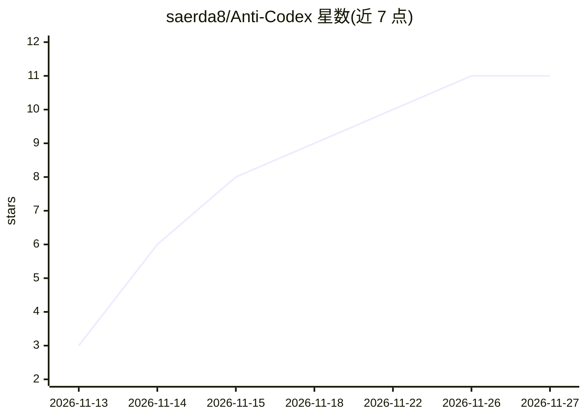

# saerda8/Anti-Codex

⭐ 11 · JavaScript · NOASSERTION · 推送 2026-11-25 · [GitHub](https://github.com/saerda8/Anti-Codex) · 个人维护 · 中文 README

**给 Windows 官方 Codex Desktop 加第三方 API 与 Antigravity 接入的隔离副本**

从本机微软商店版官方 Codex Desktop 复制出一份带最小补丁的隔离副本（独立 exe、独立数据目录、粉色图标），可与原版同时运行且不改原版文件与登录态。模型接入层替换为本机 CodexPlusPlus 中转（127.0.0.1:18484），支持 Responses/Chat Completions 第三方 API 直连，以及 Antigravity 官方 ACP（agy）与旧版 Desktop Cascade 两条路由；任务规划、工具调用、审批仍由原生 Codex 负责。提供一键安装、跟随官方更新的同步与一键回滚脚本，仅限 Windows 10/11 x64，项目代码为非商业许可。

## 筛选速览

| 维度 | 判定 | 备注 |
|---|---|---|
| AI 角色 | `ai-ecosystem` | LLM/agent 周边工具 |
| 许可风险 | `none` | NOASSERTION |
| 部署形态 | `desktop` | 安装包/桌面程序 |
| 模型依赖 | — | README 未给出锁定关系 |
| 硬件要求 | — | 无带数字的原话,不猜 |
| 安装摩擦 | `low` | 无编译、无系统依赖或容器化 |
| 成熟度 | — | 结构信号不足 |

## 能力要点

- 隔离副本与原版双开共存，独立进程名、数据目录与缓存目录
- 内置中文「管理」面板配置第三方 API，模型名自动发现
- Antigravity 双路由：官方 ACP（agy）与旧版 Desktop Cascade
- 跟随官方更新的一键同步（哈希校验门禁）与一键回滚

## 适用场景

- 想用第三方 API Key 驱动官方 Codex Desktop 而不动原版
- 想复用本机已登录 Antigravity 账号的模型和额度
- 需要在同一台机器上同时使用原版与改版客户端

## 场景标签

`编码 Agent` · 领域:编码与开发

## 证据(README 行号)

> L15: **Anti-Codex** 是一份与原版完全隔离、互不干扰的官方 Codex Desktop 副本（`isolated` `official Codex`）。它 **100% 保留官方 Codex 的原生界面、交互体验与底层代理
> L61: 2. **第二层：CodexPlusPlus 通用接入层（General Provider Layer）**
> L211: - 本项目是个人工具，与 OpenAI、Antigravity 官方均无关联。旧版兼容入口使用 Antigravity Desktop 的本地 Cascade 服务；官方入口使用 `agy acp`。两种接口与模型目录都可能随 

## 星数曲线

2026-11-13 3 → 2026-11-27 11（+8）

---
*卡片 v1 · prompt 1.4 · 生成 2026-11-20 · 置信度 high · 依据 README sha `30639fea048f` · [字段定义](../../DATASET.md)*
