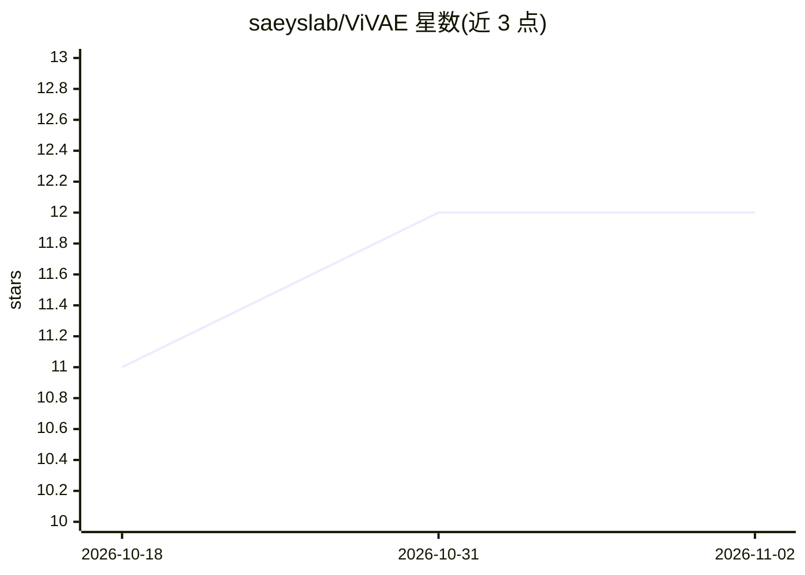

# saeyslab/ViVAE

⭐ 12 · Jupyter Notebook · Apache-2.0 · 推送 2026-09-04 · [GitHub](https://github.com/saeyslab/ViVAE) · 组织维护

**单细胞数据去噪与降维工具包（基于 VAE）**

基于 PyTorch 变分自编码器（VAE）的单细胞数据去噪与降维 Python 工具包，主要面向 scRNA-seq 数据设计与测试，也可直接用于流式/质谱细胞术数据。模型是参数化的，支持迁移学习与新样本嵌入，实现 encoder indicatrices 度量潜空间局部失真，并可集成 FlowSOM 做可视化。默认启用 PyTorch 确定性模式，支持 CPU 运行及可选的 CUDA/MPS GPU 加速；提供 Jupyter notebook 教程、R（reticulate）教程入口及配套的 ViScore 评测框架，方法细节见随附论文。

## 筛选速览

| 维度 | 判定 | 备注 |
|---|---|---|
| AI 角色 | `ai-native` | 本体是模型或模型工具 |
| 许可风险 | `permissive` | Apache-2.0 |
| 部署形态 | `library` | 以包/库形式分发 |
| 模型依赖 | — | README 未给出锁定关系 |
| 硬件要求 | — | 无带数字的原话,不猜 |
| 安装摩擦 | `medium` | 含编译或系统依赖之一 |
| 成熟度 | — | 结构信号不足 |

## 能力要点

- 基于 VAE 的参数化模型，支持迁移学习与新点嵌入
- encoder indicatrices 度量潜空间局部失真
- 默认启用 PyTorch 确定性模式，可用环境变量切换 CUDA/MPS 后端
- 集成 FlowSOM 用于细胞术数据可视化，配套 ViScore 评测框架

## 适用场景

- 对 scRNA-seq 数据做去噪与结构保持的降维嵌入
- 对流式/质谱细胞术数据做降维并生成 FlowSOM 图视图
- 用 ViScore 框架评测与基准对比降维方法

## 场景标签

 · 领域:生物信息学/单细胞分析

## 证据(README 行号)

> L5: ViVAE (*vee-vay*) is a toolkit for single-cell data denoising and dimensionality reduction.
> L147: The ViVAE model is based on a variational autoencoder (VAE).
> L29: ViVAE is a Python package based on PyTorch.

## 星数曲线

2026-10-18 11 → 2026-11-02 12（+1）

---
*卡片 v1 · prompt 1.4 · 生成 2026-11-01 · 置信度 high · 依据 README sha `5fda99cd65f2` · [字段定义](../../DATASET.md)*
