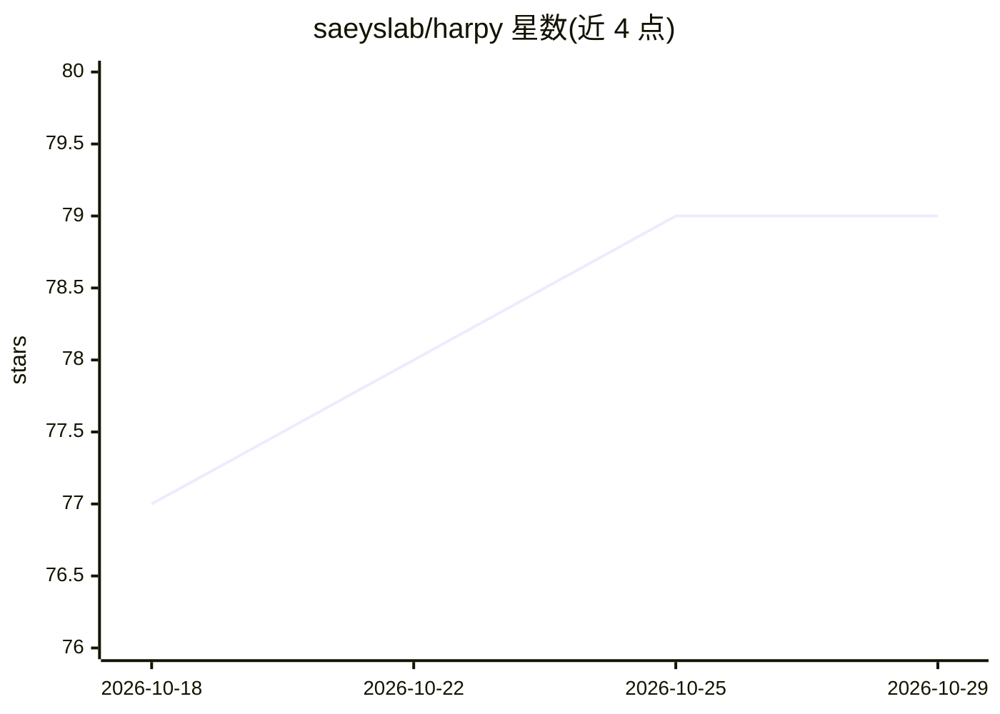

# saeyslab/harpy

⭐ 79 · Python · BSD-3-Clause · 推送 2026-10-26 · [GitHub](https://github.com/saeyslab/harpy) · [官网](https://harpy.readthedocs.io/en/latest/) · 组织维护

**空间组学（转录组/蛋白组）单细胞分析库**

scverse 生态中的空间组学分析 Python 库：读取空间转录组与蛋白组数据，提供核外图像预处理、分块细胞分割、特征聚合生成 AnnData 表、像素/细胞级聚类与深度特征提取，输出基于 SpatialData 的可互操作结果。分割与深度特征依赖可选组件（Cellpose、Instanseg、KRONOS 基础模型），大图处理用 Dask，可选 CuPy/PyTorch GPU 加速。面向生物信息学分析的开发者与科研用户，配套教程、napari 交互接口与基准测试。

## 筛选速览

| 维度 | 判定 | 备注 |
|---|---|---|
| AI 角色 | `ai-native` | 本体是模型或模型工具 |
| 许可风险 | `permissive` | BSD-3-Clause |
| 部署形态 | `library` | 以包/库形式分发 |
| 模型依赖 | — | README 未给出锁定关系 |
| 硬件要求 | — | 无带数字的原话,不猜 |
| 安装摩擦 | `medium` | 含编译或系统依赖之一 |
| 成熟度 | — | 结构信号不足 |

## 能力要点

- 核外图像预处理与 Dask 分块工作流，支持超大图像与可选 GPU 加速
- 从图像/分割掩码/转录本坐标生成 AnnData 表与单细胞表征
- 像素与细胞级无监督聚类（FlowSOM 可选）
- 深度特征提取（KRONOS 蛋白组基础模型）与浅层特征提取

## 适用场景

- 处理 Xenium、MACSima 等平台的空间组学数据并做细胞分割
- 从高多重免疫荧光图像构建单细胞表征并训练下游分类器
- 在 Scanpy/Squidpy 生态中衔接 SpatialData 数据做下游分析

## 场景标签

`科研工具` · 领域:学习与行业

## 证据(README 行号)

> L33: In practice, Harpy offers fast, out-of-core image preprocessing, tiled segmentation, along with efficient aggregati
> L130:  Discover how `Harpy` enables fast, scalable extraction of deep, cell-level features from multiplex imaging data w
> L54: - Segmentation: `cellpose`, `instanseg-torch`

## 星数曲线

2026-10-18 77 → 2026-10-29 79（+2）

---
*卡片 v1 · prompt 1.4 · 生成 2026-10-24 · 置信度 high · 依据 README sha `b29c2ac6eb37` · [字段定义](../../DATASET.md)*
