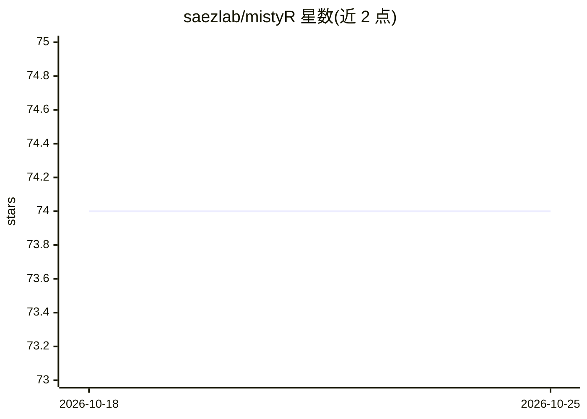

# saezlab/mistyR

⭐ 74 · R · GPL-3.0 · 推送 2026-01-15 · [GitHub](https://github.com/saezlab/mistyR) · [官网](https://saezlab.github.io/mistyR/) · 组织维护

**分析空间组学数据的可解释多视角机器学习框架（R 包）**

mistyR 是实现 MISTy 框架的 R/Bioconductor 包，面向单细胞高多重空间分辨数据：通过定义多个空间视角（如胞内调控、旁分泌调控、细胞类型特异关系、解剖区域间关系），刻画每个视角对各标记基因表达变异的贡献，并以与其他标记的交互解释该贡献。框架模块化、可并行，支持百万级细胞样本。需 R 4.0 以上，经 Bioconductor、GitHub 或 Docker 安装；README 同时指出更新版本在 jtanevski/mistyR 活跃开发。

## 筛选速览

| 维度 | 判定 | 备注 |
|---|---|---|
| AI 角色 | `ai-native` | 本体是模型或模型工具 |
| 许可风险 | `viral` | GPL-3.0 |
| 部署形态 | `self-host` | docker 或自建部署 |
| 模型依赖 | — | README 未给出锁定关系 |
| 硬件要求 | — | 无带数字的原话,不猜 |
| 安装摩擦 | `low` | 无编译、无系统依赖或容器化 |
| 成熟度 | — | 结构信号不足 |

## 能力要点

- 多视角建模：胞内/胞间/细胞类型特异等空间关系均可用作视角
- 解释每个视角对标记表达变异的贡献及关键交互
- 模块化、可并行，支持百万细胞与数千标记规模
- 提供 Bioconductor/GitHub/Docker 三种安装途径与示例管线

## 适用场景

- 剖析空间转录组中标记基因的胞内与胞间调控关系
- 为高多重空间数据生成可解释的关系表征与假设
- 在 R 环境中复用 Bioconductor 生态处理空间组学数据

## 场景标签

 · 领域:生物信息学/空间组学

## 证据(README 行号)

> L7: The advancement of technologies for measurement of highly multiplexed spatial data require the development of scalab
> L9: MISTy facilitates an in-depth understanding of marker interactions by profiling the intra- and intercellular relatio

## 星数曲线

2026-10-18 74 → 2026-10-25 74（+0）

---
*卡片 v1 · prompt 1.4 · 生成 2026-10-24 · 置信度 high · 依据 README sha `2fedfe027567` · [字段定义](../../DATASET.md)*
