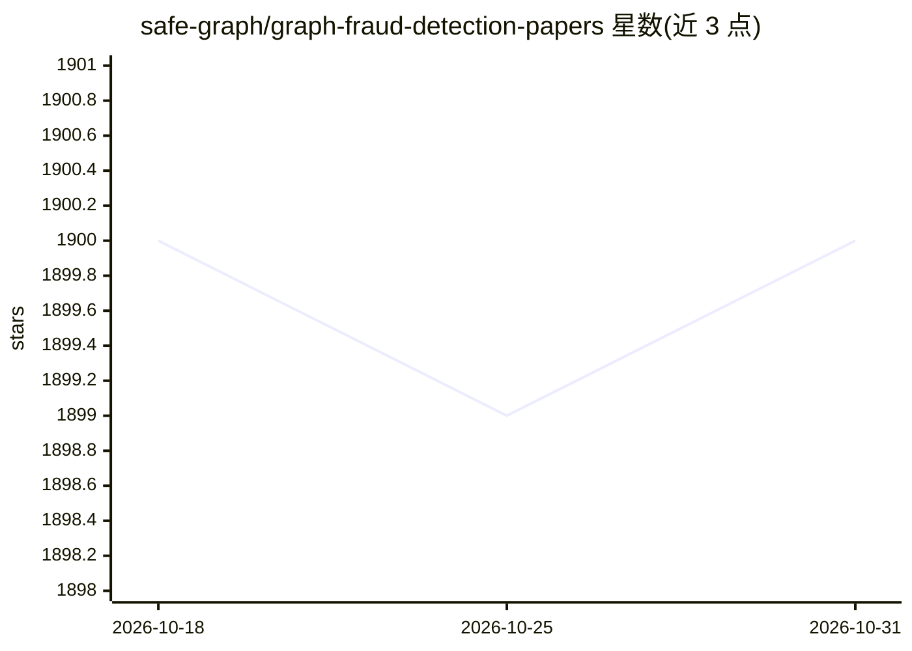

# safe-graph/graph-fraud-detection-papers

⭐ 1,900 · 推送 2026-09-13 · [GitHub](https://github.com/safe-graph/graph-fraud-detection-papers) · [官网](https://safe-graph.github.io/paper_dashboard/) · 组织维护

**图/Transformer 欺诈与异常检测论文的策展清单**

由 safe-graph 维护的论文与资源策展清单：收录基于图神经网络与 LLM/Transformer 的欺诈、异常、离群点检测研究，按 LLM/Transformer 论文与深度图学习论文两大类组织，后者再按年份（2026 至 2020 以前）分组；每条含年份、标题、发表会议/期刊及论文与代码链接，覆盖 KDD、NeurIPS、AAAI、IEEE TKDE 等来源。另提供交互式仪表盘查看/过滤/检索论文，以及基于本地 RAG 的 LLM 聊天机器人（含 250 篇公开论文）供个人部署使用。

## 筛选速览

| 维度 | 判定 | 备注 |
|---|---|---|
| AI 角色 | `ai-knowledge` | 知识聚合/清单类 |
| 许可风险 | `none` | — |
| 部署形态 | `None` |  |
| 模型依赖 | — | README 未给出锁定关系 |
| 硬件要求 | — | 无带数字的原话,不猜 |
| 安装摩擦 | `low` | 无编译、无系统依赖或容器化 |
| 成熟度 | — | 结构信号不足 |

## 能力要点

- 按 LLM/Transformer 与深度图学习两大类、按年份组织的论文清单
- 条目包含发表会议与论文/代码链接
- 交互式仪表盘支持查看、过滤与检索
- 附本地 RAG LLM 聊天机器人（250 篇论文）

## 适用场景

- 查找图神经网络与 LLM 用于欺诈/异常检测的最新论文
- 按年份和会议追踪欺诈检测研究进展
- 获取论文对应的开源代码入口

## 场景标签

`精选清单` · 领域:学习与行业

## 证据(README 行号)

> L3: A curated list of Graph/Transformer-based papers and resources for fraud, anomaly, and outlier detection.
> L7: To facilitate deep research, we developed a local RAG-based LLM chatbot with 250 publicly accessible papers. Please 

## 星数曲线

2026-10-18 1,900 → 2026-10-31 1,900（+0）

---
*卡片 v1 · prompt 1.4 · 生成 2026-10-21 · 置信度 high · 依据 README sha `8c7d07669d59` · [字段定义](../../DATASET.md)*
