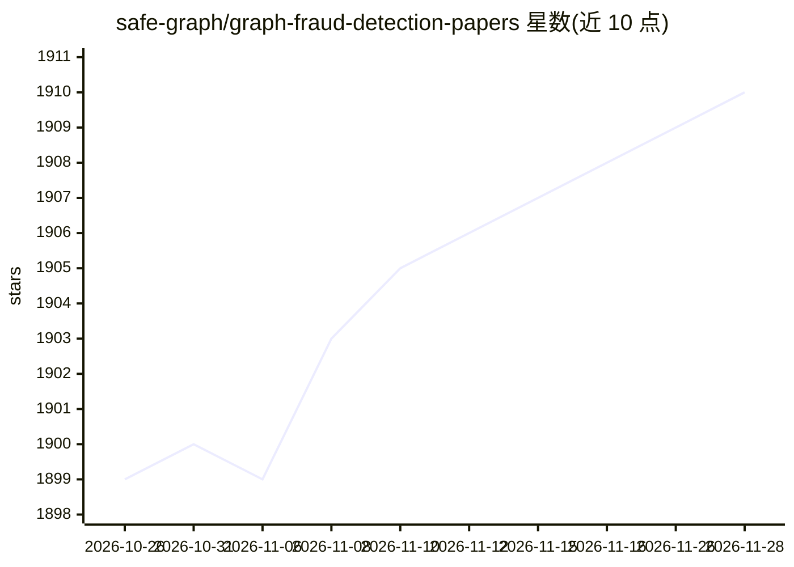

# safe-graph/graph-fraud-detection-papers

⭐ 1,910 · 推送 2026-11-15 · [GitHub](https://github.com/safe-graph/graph-fraud-detection-papers) · [官网](https://safe-graph.github.io/paper_dashboard/) · 组织维护

**面向反欺诈研究者的图/Transformer 检测论文清单**

按论文清单（awesome list）形式组织的资源汇总：收录基于图神经网络与 Transformer/LLM 的欺诈、异常与离群检测论文，按「LLM 与 Transformer 论文」「深度学习图论文」分类，后者再按年份（2020 以前至 2026）分节，每条含标题、发表会议/期刊及论文与代码链接。另提供可交互的论文筛选看板，并配套一个基于 250 篇公开论文的本地 RAG 聊天机器人（部署方式见其项目 README），便于研究者检索与深读。

## 筛选速览

| 维度 | 判定 | 备注 |
|---|---|---|
| AI 角色 | `ai-knowledge` | 知识聚合/清单类 |
| 许可风险 | `none` | — |
| 部署形态 | `None` |  |
| 模型依赖 | — | README 未给出锁定关系 |
| 硬件要求 | — | 无带数字的原话,不猜 |
| 安装摩擦 | `low` | 无编译、无系统依赖或容器化 |
| 成熟度 | — | 结构信号不足 |

## 能力要点

- 收录 LLM/Transformer 与深度学习图两类欺诈/异常检测论文，按年份分节
- 每条论文条目附 Paper 与 Code 链接
- 提供可交互的论文查看/筛选看板
- 配套基于 250 篇公开论文的本地 RAG 聊天机器人

## 适用场景

- 查找图神经网络欺诈检测方向的相关论文与代码
- 跟进每年新发表的图异常检测研究
- 通过本地 RAG 机器人检索这批论文内容

## 场景标签

`精选清单` `科研工具` · 领域:学习与行业

## 证据(README 行号)

> L3: A curated list of Graph/Transformer-based papers and resources for fraud, anomaly, and outlier detection.
> L5: We have an interactive dashboard to view/filter/search the papers listed in this repo.
> L7: To facilitate deep research, we developed a local RAG-based LLM chatbot with 250 publicly accessible papers. Please 

## 星数曲线

2026-10-26 1,899 → 2026-11-28 1,910（+11）

---
*卡片 v1 · prompt 1.4 · 生成 2026-11-24 · 置信度 high · 依据 README sha `1cbc54055fd3` · [字段定义](../../DATASET.md)*
