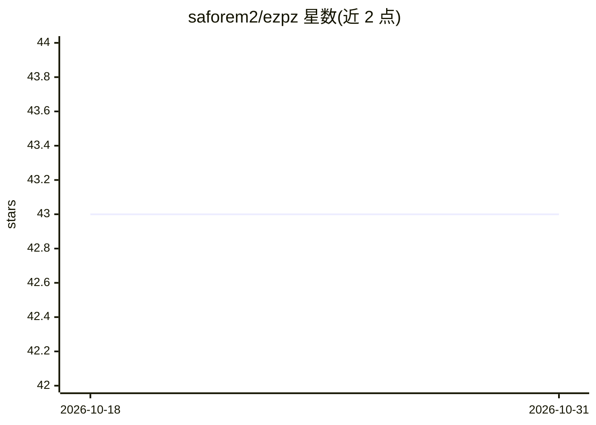

# saforem2/ezpz

⭐ 43 · Python · MIT · 推送 2026-10-29 · [GitHub](https://github.com/saforem2/ezpz) · [官网](http://ezpz.cool/) · 个人维护

**跨硬件的分布式 PyTorch 训练启动器：零代码改动**

Python 库与 CLI 工具，使分布式 PyTorch 启动在不同硬件（NVIDIA/AMD/Intel/MPS/CPU）间可移植：自动检测设备并选择对应后端（CUDA/NCCL、XPU/CCL、MPS、CPU/Gloo），同一脚本可从笔记本运行到千节点超算。原生集成 PBS 与 SLURM 调度器，自动发现 hostfile 并分配 rank；提供 ezpz launch/submit/test/benchmark/doctor 命令、训练指标记录的 History 类。作者称其包装分布式初始化而非替代 DeepSpeed 等下层框架。

## 筛选速览

| 维度 | 判定 | 备注 |
|---|---|---|
| AI 角色 | `ai-ecosystem` | LLM/agent 周边工具 |
| 许可风险 | `permissive` | MIT |
| 部署形态 | `library` | 以包/库形式分发 |
| 模型依赖 | — | README 未给出锁定关系 |
| 硬件要求 | — | 无带数字的原话,不猜 |
| 安装摩擦 | `medium` | 含编译或系统依赖之一 |
| 成熟度 | — | 结构信号不足 |

## 能力要点

- 自动设备检测与后端选择（CUDA/NCCL、XPU/CCL、MPS、CPU/Gloo）
- 原生 PBS/SLURM 支持，自动 hostfile 发现与 rank 分配
- ezpz launch/submit/test/doctor 等 CLI 工具
- 内置 History 类记录与绘制训练指标

## 适用场景

- 让同一训练脚本在笔记本、单 GPU 与超算集群间迁移
- 向 PBS/SLURM 提交分布式训练批处理作业
- 诊断分布式训练环境问题（ezpz doctor）

## 场景标签

`模型训练` · 领域:训练与推理

## 证据(README 行号)

> L5: `ezpz` makes distributed PyTorch launches portable across any supported
> L14: - **HPC integration** — native PBS and SLURM support with automatic hostfile

## 星数曲线

2026-10-18 43 → 2026-10-31 43（+0）

---
*卡片 v1 · prompt 1.4 · 生成 2026-10-25 · 置信度 mid · 依据 README sha `37035a7a3cbc` · [字段定义](../../DATASET.md)*
