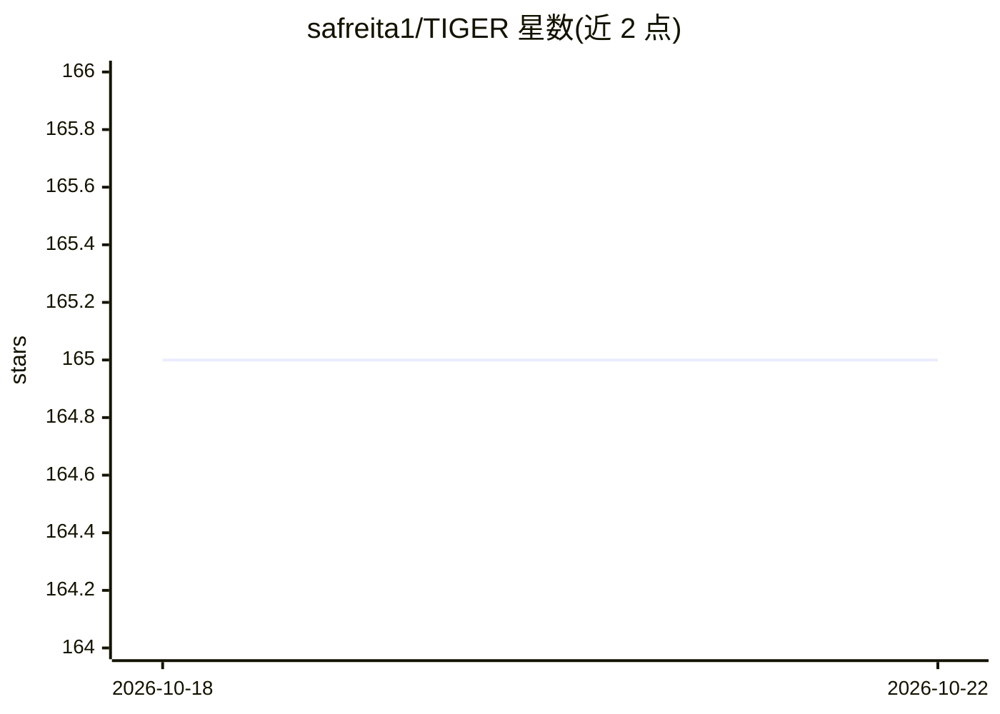

# safreita1/TIGER

⭐ 166 · Python · MIT · 推送 2026-09-13 · [GitHub](https://github.com/safreita1/TIGER) · [官网](https://graph-tiger.readthedocs.io) · 个人维护

**图脆弱性与鲁棒性研究工具箱：量化、攻击模拟与防御增强**

Python 图分析工具箱（CIKM 2021 资源论文配套），面向图结构数据的脆弱性与鲁棒性研究：实现 20 余种鲁棒性度量（谱半径、有效电阻、连通性等）、30 余种节点/边攻击策略、20 余种防御策略（接种、加边、重连），并内置级联失效、SIS 病毒传播等信息/流行病扩散模拟框架。默认 CPU 安装，可选 NVIDIA GPU 加速（CUDA 12/13，CuPy 与 nx-cugraph），部分谱类度量支持 GPU 加速。提供 pip 安装与源码安装两种方式。

## 筛选速览

| 维度 | 判定 | 备注 |
|---|---|---|
| AI 角色 | `ai-native` | 本体是模型或模型工具 |
| 许可风险 | `permissive` | MIT |
| 部署形态 | `library` | 以包/库形式分发 |
| 模型依赖 | — | README 未给出锁定关系 |
| 硬件要求 | `cpu-ok` | |
| 安装摩擦 | `medium` | 含编译或系统依赖之一 |
| 成熟度 | — | 结构信号不足 |

## 能力要点

- 20+ 种图鲁棒性度量，其中 7 种谱类度量支持 GPU 加速
- 30+ 种节点/边移除攻击策略（Netshield、PageRank、度/介数中心性等）
- 20+ 种防御策略：节点接种、加边、边重连
- 级联失效（Motter-Lai/Crucitti）与 SIS 等传播模拟框架，支持可视化与动画输出

## 适用场景

- 研究基础设施或社交网络在 targeted 攻击下的鲁棒性
- 模拟级联失效或病毒/信息在网络上的扩散过程
- 对比不同防御策略对网络抗毁性的提升效果

## 场景标签

 · 领域:图挖掘/网络科学

## 证据(README 行号)

> L11: **TIGER** is a Python toolbox to conduct graph vulnerability and robustness research. TIGER contains numerous
> L15: 1. **Quantify** network *vulnerability* and *robustness*,
> L16: 2. **Simulate** network attacks, cascading failures, epidemics, and information or opinion diffusion

## 星数曲线

2026-10-18 165 → 2026-10-22 165（+0）

---
*卡片 v1 · prompt 1.4 · 生成 2026-10-22 · 置信度 high · 依据 README sha `97201503b137` · [字段定义](../../DATASET.md)*
