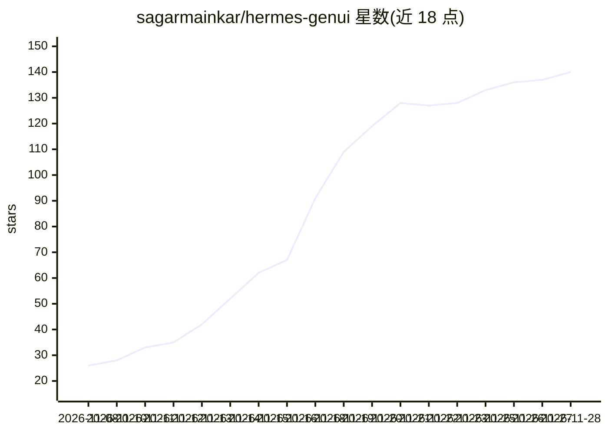

# sagarmainkar/hermes-genui

⭐ 140 · TypeScript · MIT · 推送 2026-11-26 · [GitHub](https://github.com/sagarmainkar/hermes-genui) · 个人维护

**为 Hermes Agent 生成式 UI 的插件：聊天内绘制图表/表格/计算器**

Hermes Agent 的插件，让 Hermes Desktop 与 Webapp 的聊天回复中直接呈现交互式 UI：图表、表格、时间线、照片条、带实时图表的计算器、可记忆勾选状态的表单与清单、分步讲解等。模型决定展示内容，插件负责统一样式（跟随明暗主题与本地数字格式）。0.3 版加入由一句话设置的个人助手维护的 Today 页面，以及基于 MCP 服务器/工具数据、可固定到侧栏并刷新的仪表盘。Telegram 与 CLI 等场景自动回退为纯文本。

## 筛选速览

| 维度 | 判定 | 备注 |
|---|---|---|
| AI 角色 | `ai-ecosystem` | LLM/agent 周边工具 |
| 许可风险 | `permissive` | MIT |
| 部署形态 | `None` |  |
| 模型依赖 | — | README 未给出锁定关系 |
| 硬件要求 | — | 无带数字的原话,不猜 |
| 安装摩擦 | `low` | 无编译、无系统依赖或容器化 |
| 成熟度 | — | 结构信号不足 |

## 能力要点

- 聊天内渲染图表、表格、计划、计算器、表单、清单与讲解板块
- Today 个人助手页面（每 30 分钟检查邮件与日历，跟踪账单/续订/订单）
- 基于 MCP 服务器与自有数据的侧栏仪表盘，可刷新
- 支持 Hermes Desktop、Webapp（含手机浏览器），Telegram/CLI 文本回退

## 适用场景

- 让 Agent 回答市场行情时直接给出可交互的价格图表
- 用一句话配置个人助手，跟踪账单、续订与待回复邮件
- 把自有 MCP 数据画成仪表盘固定在侧栏定期刷新
- 需要分步讲解或带滑块的计算器式交互问答

## 场景标签

`AI 助手` `聊天机器人` · 领域:对话与助手

## 证据(README 行号)

> L34: The model decides **what** to show. The plugin decides **how** it looks, so every answer comes out in one
> L60: You need Hermes Agent 0.22.5 or later with Hermes Desktop or the
> L49:  from your MCP servers and tools. **Keep in sidebar** turns it into a page; **Refresh** redraws it with fresh numbe

## 星数曲线

2026-11-08 26 → 2026-11-28 140（+114）

---
*卡片 v1 · prompt 1.4 · 生成 2026-11-28 · 置信度 high · 依据 README sha `f1c5faccfab7` · [字段定义](../../DATASET.md)*
