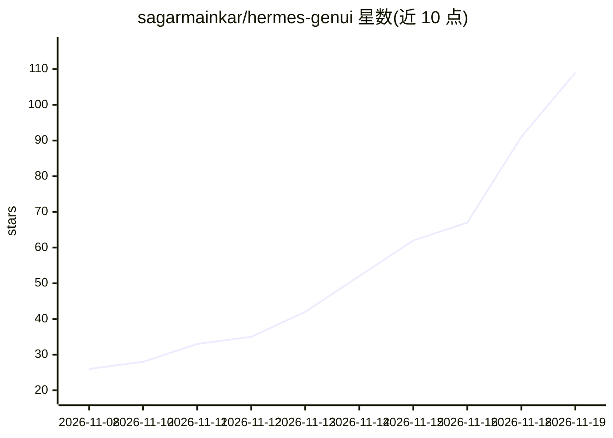

# sagarmainkar/hermes-genui

⭐ 109 · Python · MIT · 推送 2026-11-18 · [GitHub](https://github.com/sagarmainkar/hermes-genui) · 个人维护

**Hermes Agent 插件：让聊天回复直接生成图表、表格与仪表盘**

面向 Hermes Agent（0.22.5+）的生成式 UI 插件：模型决定展示什么内容，插件决定呈现形式，在 Hermes Desktop 与 Webapp 的聊天中绘制图表、表格、行程计划、计算器、表单、分步图解等交互组件；0.3 新增 Today 个人助理页（每 30 分钟检查邮件与日历、跟踪账单/续订/订单）和基于 MCP 数据的侧边栏仪表盘。通过 hermes plugins install 命令或 Desktop 界面安装。限制：iPhone/iPad 的 Webapp 无法渲染；Telegram 与 CLI 回退为纯文本；关闭工具搜索会增加 token 消耗。

## 筛选速览

| 维度 | 判定 | 备注 |
|---|---|---|
| AI 角色 | `ai-ecosystem` | LLM/agent 周边工具 |
| 许可风险 | `permissive` | MIT |
| 部署形态 | `None` |  |
| 模型依赖 | — | README 未给出锁定关系 |
| 硬件要求 | — | 无带数字的原话,不猜 |
| 安装摩擦 | `low` | 无编译、无系统依赖或容器化 |
| 成熟度 | — | 结构信号不足 |

## 能力要点

- 在聊天内绘制图表、表格、计划、计算器、表单等交互 UI
- Today 个人助理页：定时检查邮件与日历，跟踪账单、续订与订单
- 从 MCP 服务器数据生成可保存、可刷新的侧边栏仪表盘
- 照片功能默认无需 API key（Wikimedia Commons、Openverse 等来源）

## 适用场景

- 让我的 Hermes 助手用图表而非大段文字回答行情比较
- 用一个句子里设置个人助理，自动跟踪账单和续订
- 把自己的 MCP 数据源做成常驻侧边栏仪表盘

## 场景标签

`数据分析` · 领域:效率与自动化

## 证据(README 行号)

> L34: The model decides **what** to show. The plugin decides **how** it looks, so every answer comes out in one
> L9: **Ask "How's the market?" and get a chart, not a paragraph.** Hermes GenUI lets your Hermes agent answer with

## 星数曲线

2026-11-08 26 → 2026-11-19 109（+83）

---
*卡片 v1 · prompt 1.4 · 生成 2026-11-18 · 置信度 high · 依据 README sha `bf674121ef64` · [字段定义](../../DATASET.md)*
