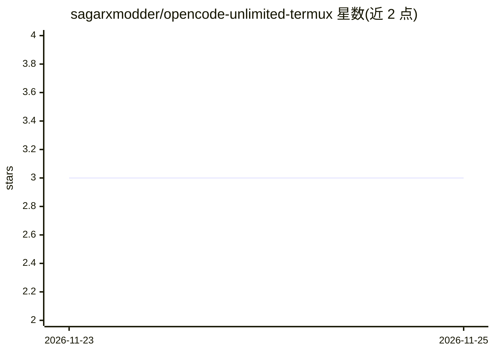

# sagarxmodder/opencode-unlimited-termux

⭐ 3 · JavaScript · MIT · 推送 2026-11-22 · [GitHub](https://github.com/sagarxmodder/opencode-unlimited-termux) · [官网](https://kuru-vanthex-production.up.railway.app) · 个人维护

**Termux/Android 上绕过 opencode 免费模型每日限额的轮换工具**

通过轮换 Cloudflare WARP 身份（IPv6 /64 与边缘节点）绕过 opencode 免费模型的每日用量限制。Termux/Android 无 root 路线使用用户态 WARP（MASQUE）经本地 HTTP 代理转发，Linux/WSL2 路线用 systemd 服务：keeper 保活隧道与 kill-switch 防火墙，zen-guard 监测限额错误并自动重新注册 WARP 获取新 /64，烧毁的 /64 进入终身黑名单。附带 zycron-ai，一个本地优先的编码 agent 服务。

## 筛选速览

| 维度 | 判定 | 备注 |
|---|---|---|
| AI 角色 | `ai-ecosystem` | LLM/agent 周边工具 |
| 许可风险 | `permissive` | MIT |
| 部署形态 | `None` |  |
| 模型依赖 | local-ok | 支持本地模型 |
| 硬件要求 | — | 无带数字的原话,不猜 |
| 安装摩擦 | `low` | 无编译、无系统依赖或容器化 |
| 成熟度 | — | 结构信号不足 |

## 能力要点

- Termux/Android 无 root 用户态 WARP 轮换（MASQUE，无需 iptables/sudo）
- zen-guard 后台监测限额错误，约 10 秒轮换出未被烧毁的新 /64
- kill-switch 防火墙链防止真实 IP 泄漏
- zycron-ai 支持 14 个 provider、49 个模型（44 个免费），免费模型优先路由

## 适用场景

- 在 Android/Termux 上运行 opencode 时绕过免费额度墙
- 在 Linux/WSL2 上自动轮换 WARP 身份继续会话
- 用 zycron-ai 在本地跑一个免费模型优先的编码 agent

## 场景标签

`编码 Agent` `模型网关` · 领域:Agent 开发

## 证据(README 行号)

> L3: Bypass opencode's free-model daily usage wall by rotating Cloudflare WARP
> L93: - when the wall hits anyway, a background watcher (zen-guard) re-registers WARP in ~10 seconds and you land on a **
> L57: - 14 providers, 49 models, 44 of them free (OpenRouter, Groq, Gemini,

## 星数曲线

2026-11-23 3 → 2026-11-25 3（+0）

---
*卡片 v1 · prompt 1.4 · 生成 2026-11-23 · 置信度 high · 依据 README sha `96c9aea5a9c8` · [字段定义](../../DATASET.md)*
