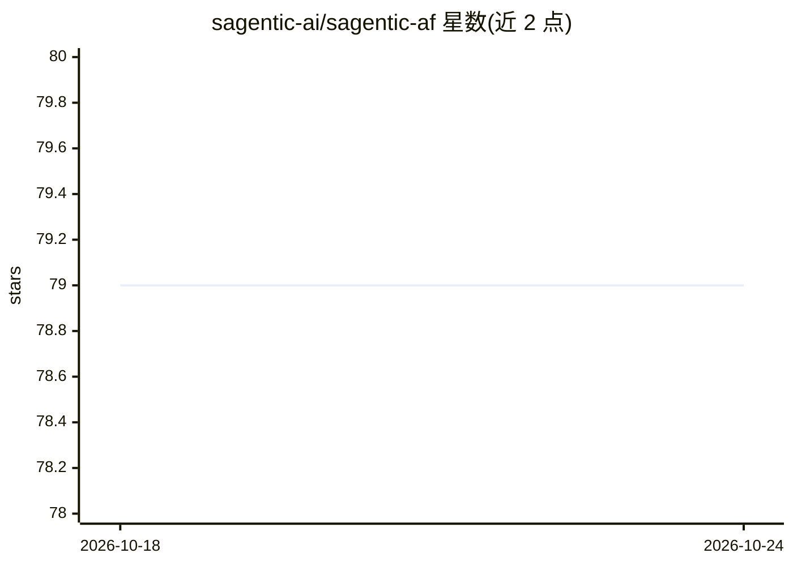

# sagentic-ai/sagentic-af

⭐ 79 · TypeScript · NOASSERTION · 推送 2026-06-09 · [GitHub](https://github.com/sagentic-ai/sagentic-af) · [官网](https://sagentic.ai) · 组织维护

**TypeScript 自主 Agent 框架：构建、运行与扩展 Agent 应用**

Sagentic.ai Agent Framework 是面向 TypeScript 开发者的自主 Agent 开发框架，配套统一平台用于构建、运行和扩展 Agent。通过 npx 脚手架初始化项目，内置带热重载的开发服务器，可通过 HTTP /spawn 端点在本地启动指定类型的 Agent 实例。采用 Business Source License 1.1 许可（非 OSI 开源许可），并声明可联系获取替代授权安排。README 信息有限，详细能力需查阅其外部文档。

## 筛选速览

| 维度 | 判定 | 备注 |
|---|---|---|
| AI 角色 | `ai-ecosystem` | LLM/agent 周边工具 |
| 许可风险 | `none` | NOASSERTION |
| 部署形态 | `library` | 以包/库形式分发 |
| 模型依赖 | — | README 未给出锁定关系 |
| 硬件要求 | — | 无带数字的原话,不猜 |
| 安装摩擦 | `low` | 无编译、无系统依赖或容器化 |
| 成熟度 | — | 结构信号不足 |

## 能力要点

- npx 脚手架一键初始化 Agent 项目
- 带热重载的 dev server（yarn dev / npm run dev）
- HTTP POST /spawn 端点本地启动 Agent
- 主题标签含 gpt-4、openai、llm、autonomous-agents

## 适用场景

- TypeScript 开发者搭建自主 Agent 应用
- 通过 HTTP 端点在本地生成和运行 Agent
- 在带热重载的开发环境中迭代 Agent 逻辑

## 场景标签

`Agent 框架` · 领域:Agent 开发

## 证据(README 行号)

> L1: # 😎 Sagentic.ai Agent Framework
> L35: You can spawn agents locally by calling `/spawn` endpoint:

## 星数曲线

2026-10-18 79 → 2026-10-24 79（+0）

---
*卡片 v1 · prompt 1.4 · 生成 2026-10-24 · 置信度 mid · 依据 README sha `21d29bb99b20` · [字段定义](../../DATASET.md)*
