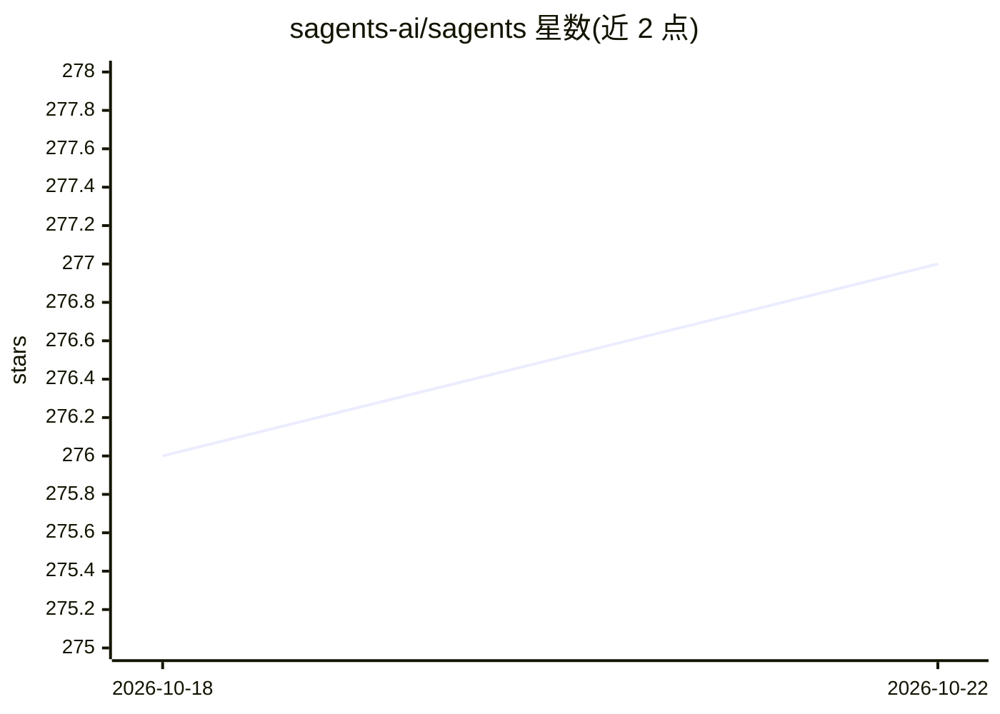

# sagents-ai/sagents

⭐ 277 · Elixir · NOASSERTION · 推送 2026-10-10 · [GitHub](https://github.com/sagents-ai/sagents) · 组织维护

**面向 Elixir 开发者的交互式 AI Agent 编排框架**

构建于 Elixir LangChain 之上的 Agent 编排层：每个 agent 以受监督的 OTP GenServer 进程运行，支持 Human-In-The-Loop 工具审批（含并行工具逐个审批、SubAgent 中断向父级传播）、显式可组合执行管线、until_tool 结构化完成、SubAgent 委派、虚拟文件系统、状态持久化、PubSub 实时事件与 Phoenix LiveView 集成，并提供 mix 生成器脚手架会话持久层与可选 Horde 集群分布。面向需实时对话、人工监督与多并发隔离会话的 Elixir 交互式应用开发者，需配置 LLM provider API key 使用。

## 筛选速览

| 维度 | 判定 | 备注 |
|---|---|---|
| AI 角色 | `ai-ecosystem` | LLM/agent 周边工具 |
| 许可风险 | `none` | NOASSERTION |
| 部署形态 | `None` |  |
| 模型依赖 | locked-api |  |
| 硬件要求 | — | 无带数字的原话,不猜 |
| 安装摩擦 | `low` | 无编译、无系统依赖或容器化 |
| 成熟度 | — | 结构信号不足 |

## 能力要点

- 每个 agent 运行为受监督 OTP 进程，带生命周期管理与闲置关停
- HITL 审批系统支持并行工具逐个批准/编辑/拒绝，SubAgent 中断向上传播
- 可组合中间件：TodoList、虚拟 FileSystem、SubAgent、Summarization 等
- mix sagents.setup 生成器产出持久层、Factory 与 Coordinator 模块

## 适用场景

- 构建带人工审批的实时对话 AI 应用
- 将复杂任务委派给 SubAgent 并行执行
- 为 Phoenix LiveView 应用接入多并发隔离的 agent 会话

## 场景标签

`Agent 框架` · 领域:Agent 开发

## 证据(README 行号)

> L5: A sage is a person who has attained wisdom and is often characterized by sound judgment and deep understanding. Sage
> L71: Sagents builds on the Elixir LangChain library for LLM integration. To use Sagents, you need to configure an LLM pr

## 星数曲线

2026-10-18 276 → 2026-10-22 277（+1）

---
*卡片 v1 · prompt 1.4 · 生成 2026-10-18 · 置信度 high · 依据 README sha `65bc9339022a` · [字段定义](../../DATASET.md)*
