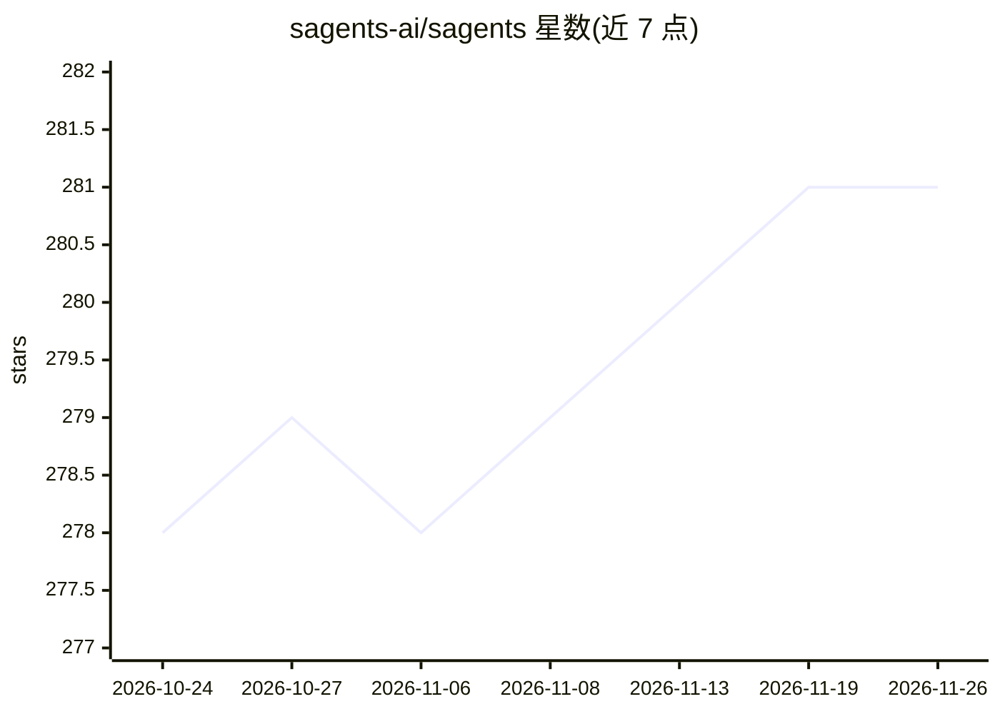

# sagents-ai/sagents

⭐ 281 · Elixir · NOASSERTION · 推送 2026-11-19 · [GitHub](https://github.com/sagents-ai/sagents) · 组织维护

**Elixir 开发者构建带人工审批的交互式 AI Agent 框架**

基于 Elixir LangChain 库的 Agent 编排层：每个 Agent 运行为受 OTP 监督树管理的 GenServer 进程，支持通过中间件组合（TodoList、虚拟文件系统、HITL、SubAgent、摘要压缩等）与可自定义的执行流水线构建 Agent 运行循环。提供敏感操作的人工审批中断/恢复机制、结构化完成契约 until_tool、Phoenix LiveView 实时事件推送、可选 Horde 集群分发与状态持久化，并带 mix 脚手架生成持久化层与工厂模块。面向需要在 Phoenix 应用中构建实时对话式 Agent 的 Elixir 开发者。

## 筛选速览

| 维度 | 判定 | 备注 |
|---|---|---|
| AI 角色 | `ai-ecosystem` | LLM/agent 周边工具 |
| 许可风险 | `none` | NOASSERTION |
| 部署形态 | `None` |  |
| 模型依赖 | — | README 未给出锁定关系 |
| 硬件要求 | — | 无带数字的原话,不猜 |
| 安装摩擦 | `low` | 无编译、无系统依赖或容器化 |
| 成熟度 | — | 结构信号不足 |

## 能力要点

- HITL 权限系统：敏感工具调用暂停等待人工审批，支持并行工具逐项批准，中断可向父 Agent 传播
- 可组合执行模式：Agent 运行循环为显式 Elixir 流水线，内置步骤可混搭或自写
- SubAgent 委派与虚拟文件系统隔离，GenServer 监督进程与 Phoenix.Presence 空闲回收
- mix sagents.setup 脚手架生成持久化层、工厂模块与协调模块

## 适用场景

- 在 Phoenix LiveView 应用中构建带实时界面的多会话 AI 对话
- 对文件删除、API 调用等操作要求人工审批后执行
- 运行无 UI 的后台 Agent 并通过 live_debugger 观察其状态
- 跨节点集群运行 Agent 并自动迁移状态

## 场景标签

`Agent 框架` `代码生成` · 领域:Agent 开发

## 证据(README 行号)

> L29: Sagents is designed for Elixir developers building **interactive AI applications** where:
> L37: If you're building a simple CLI tool or batch processing pipeline, the core LangChain library may be sufficient. Sa
> L71: Sagents builds on the Elixir LangChain library for LLM integration. To use Sagents, you need to configure an LLM pr

## 星数曲线

2026-10-24 278 → 2026-11-26 281（+3）

---
*卡片 v1 · prompt 1.4 · 生成 2026-11-25 · 置信度 high · 依据 README sha `fb02179eddae` · [字段定义](../../DATASET.md)*
