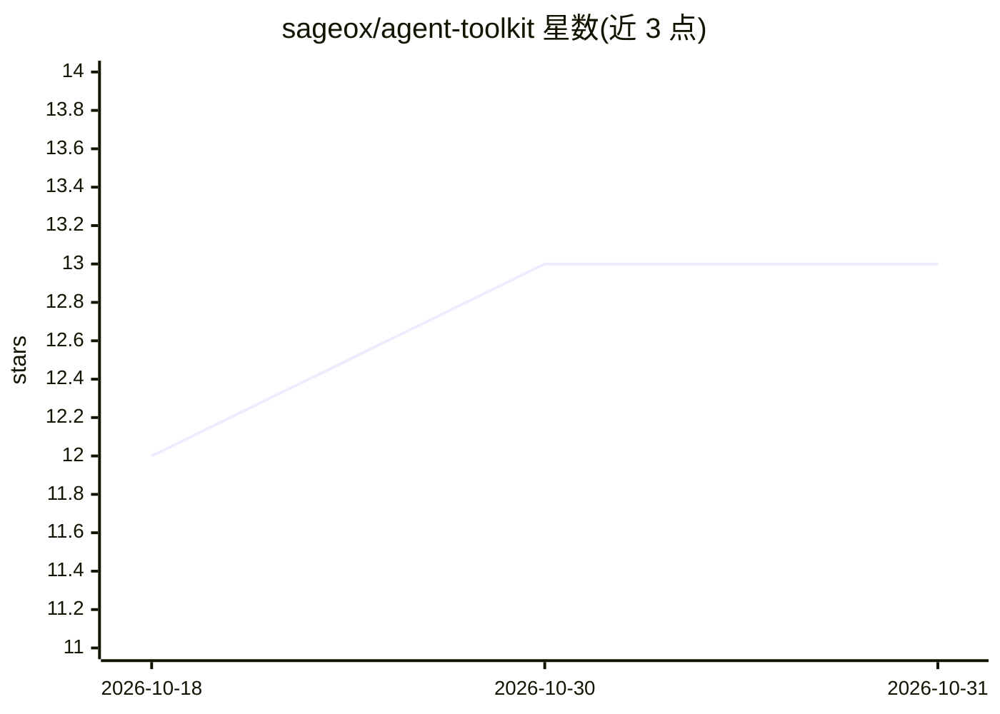

# sageox/agent-toolkit

⭐ 13 · TypeScript · MIT · 推送 2026-10-28 · [GitHub](https://github.com/sageox/agent-toolkit) · [官网](https://sageox.ai) · 组织维护

**自托管 AI 协作 agent 工具包：一个模型多渠道回复团队消息**

在自有基础设施上运行的 agent 运行时：单一网关进程持有全部凭据并管理连接，模型（Claude 或 Codex，经 ACP 接入，或本地 mock brain）通过 Buzz(Nostr) 和 Slack 并发回复，共享同一记忆与人设。安全机制上模型不持有凭据，MCP 服务器运行在网关内、工具按 scope 限权并记录审计日志；可接入 SageOx 团队知识库做只读检索。提供 CLI 创建流程、Docker Compose 与 Helm 部署。项目声明 Pre-1.0，配置格式与 CLI 参数可能变动。

## 筛选速览

| 维度 | 判定 | 备注 |
|---|---|---|
| AI 角色 | `ai-ecosystem` | LLM/agent 周边工具 |
| 许可风险 | `permissive` | MIT |
| 部署形态 | `library` | 以包/库形式分发 |
| 模型依赖 | locked-api |  |
| 硬件要求 | — | 无带数字的原话,不猜 |
| 安装摩擦 | `low` | 无编译、无系统依赖或容器化 |
| 成熟度 | `idea` | |

## 能力要点

- 一个网关进程多路复用 Buzz(Nostr) 与 Slack 渠道，跨渠道共享记忆与人设
- 模型不持有凭据：MCP 服务器在网关内运行，工具调用按 scope 限权并全量审计
- 可接入 SageOx 团队知识做只读 team_search/team_status 等检索
- 提供 Docker 镜像、Helm chart 与 Terraform 管理的 AWS/EKS 部署路径

## 适用场景

- 在 Slack 和 Nostr 渠道里部署团队自有的 AI 协作成员
- 以受控凭据和审计运行带 MCP 工具的 agent
- 让 agent 读取团队已沉淀的决策与文档回答问题

## 场景标签

`Agent 框架` `聊天机器人` · 领域:Agent 开发

## 证据(README 行号)

> L18: One process runs the agent: a gateway that owns every connection and credential, and a
> L81: |**Brains**|A mock brain for free local work, or **Claude or Codex driven over ACP**. A refused reply comes back to

## 星数曲线

2026-10-18 12 → 2026-10-31 13（+1）

---
*卡片 v1 · prompt 1.4 · 生成 2026-10-31 · 置信度 high · 依据 README sha `52e42feaf1d0` · [字段定义](../../DATASET.md)*
