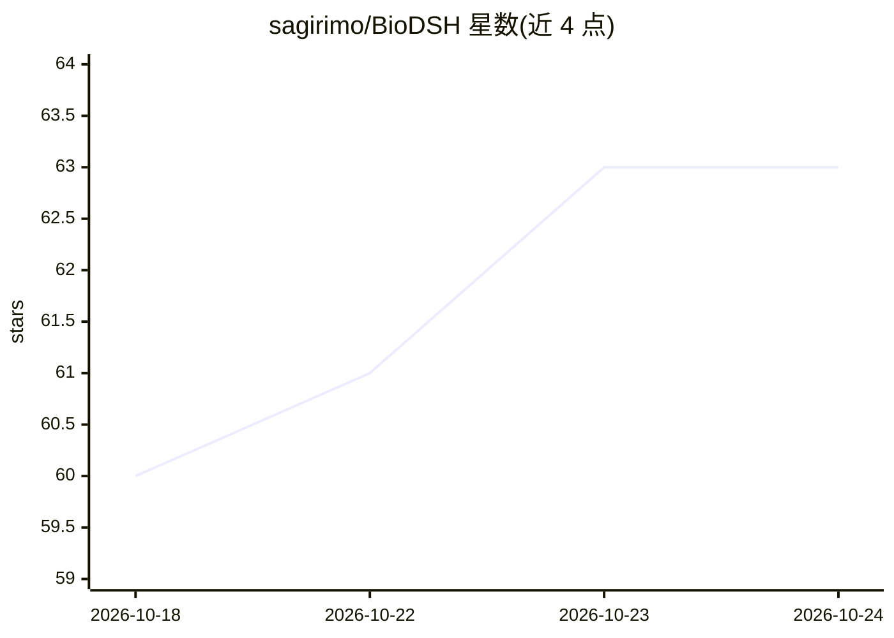

# sagirimo/BioDSH

⭐ 63 · Python · MIT · 推送 2026-10-23 · [GitHub](https://github.com/sagirimo/BioDSH) · 个人维护

**面向临床医生与湿实验科学家的无代码生物信息分析 agent 桌面应用**

基于 DeepSeek Harness (dsh) 构建的桌面应用，同时提供 dsh 插件形式。用户以自然语言描述分析需求（如单细胞 h5ad、临床表格的差异比较），agent 自动加载数据、选择技能、编写并运行代码、输出结论与图表。内置 17 个官方分析技能（单细胞 QC/聚类/生存分析/limma-voom 等），支持 2,000+ 社区技能库；提供离线模式、会话日志与工作流复用。模型可选 DeepSeek 官方 API、任意 OpenAI 兼容端点或本地模型。提供 Windows/macOS 安装包，可从源码构建。

## 筛选速览

| 维度 | 判定 | 备注 |
|---|---|---|
| AI 角色 | `ai-native` | 本体是模型或模型工具 |
| 许可风险 | `permissive` | MIT |
| 部署形态 | `desktop` | 安装包/桌面程序 |
| 模型依赖 | locked-api |  |
| 硬件要求 | — | 无带数字的原话,不猜 |
| 安装摩擦 | `low` | 无编译、无系统依赖或容器化 |
| 成熟度 | `idea` | |

## 能力要点

- 17 个官方分析技能 + 2,000+ 社区技能库，按请求自动选技
- 离线模式仅访问本机或内网模型，适配医院与实验室
- Python 分析环境（scanpy 等）首次启动自动安装
- 收敛保护机制避免长任务循环不终止

## 适用场景

- 临床医生用自然语言完成单细胞与生存分析而无需写代码
- 湿实验科学家对基因列表或计数矩阵做统计分析
- 医院内网离线环境下运行生物信息分析 agent

## 场景标签

`数据分析` `科研工具` · 领域:效率与自动化

## 证据(README 行号)

> L3: **A bioinformatics agent for clinicians and wet-lab scientists. Describe the analysis in plain language and get the 
> L11: You add your data (single-cell `h5ad`, count matrices, clinical tables, gene lists…) and ask a question such as *"D
> L13: BioDSH runs on your own computer and is built on DeepSeek Harness (dsh). It comes in two forms: a one-click **deskt

## 星数曲线

2026-10-18 60 → 2026-10-24 63（+3）

---
*卡片 v1 · prompt 1.4 · 生成 2026-10-24 · 置信度 high · 依据 README sha `35045fab7301` · [字段定义](../../DATASET.md)*
