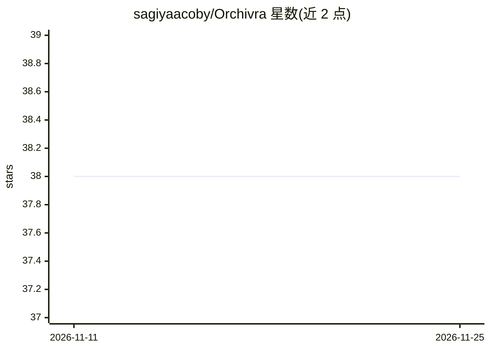

# sagiyaacoby/Orchivra

⭐ 38 · JavaScript · MIT · 推送 2026-11-10 · [GitHub](https://github.com/sagiyaacoby/Orchivra) · 个人维护

**面向 Claude Code 的自托管 AI agent 团队编排管理平台**

开源、自托管（MIT）的多 agent 编排平台：以 Claude CLI 作为 agent 的 AI 后端，通过 Web 仪表盘、Command Center 终端、任务系统（计划/版本/审批/交付物追踪）、持久化 agent 记忆、知识库与可选技能集成来管理 agent 团队；用文件范围声明防止 agent 相互覆盖。区别于创建 agent 的框架，本产品聚焦以项目管理纪律管理已运行的 agent。要求 Node.js 18+ 与 Claude CLI，git clone 源码安装后以脚本启动，仪表盘运行于 localhost:3777。

## 筛选速览

| 维度 | 判定 | 备注 |
|---|---|---|
| AI 角色 | `ai-ecosystem` | LLM/agent 周边工具 |
| 许可风险 | `permissive` | MIT |
| 部署形态 | `library` | 以包/库形式分发 |
| 模型依赖 | locked-api |  |
| 硬件要求 | — | 无带数字的原话,不猜 |
| 安装摩擦 | `low` | 无编译、无系统依赖或容器化 |
| 成熟度 | — | 结构信号不足 |

## 能力要点

- 任务全生命周期：plan → review → execute → deliver，含审批与交付物追踪
- 每个 agent 具备跨会话的持久化短期/长期记忆
- 文件范围声明（file-scope）防止多 agent 相互覆盖
- Web 仪表盘 + 集成终端 Command Center 与 orchestrator agent 对话

## 适用场景

- 我在多个 agent 协作同一项目时需要计划先行、交付物可追踪
- 我想给 Claude Code 的 agent 加上团队级项目管理结构
- 自托管一个可审计的 agent 编排平台而非托管服务

## 场景标签

`多智能体` `Agent 记忆` · 领域:Agent 开发

## 证据(README 行号)

> L3: Open-source orchestration for AI agent teams.
> L33: Most agent frameworks focus on creating agents. Orchivra focuses on managing them. The difference matters when you 
> L48: - Claude CLI - the AI backbone that powers your agents

## 星数曲线

2026-11-11 38 → 2026-11-25 38（+0）

---
*卡片 v1 · prompt 1.4 · 生成 2026-11-18 · 置信度 high · 依据 README sha `3231efbf31b7` · [字段定义](../../DATASET.md)*
