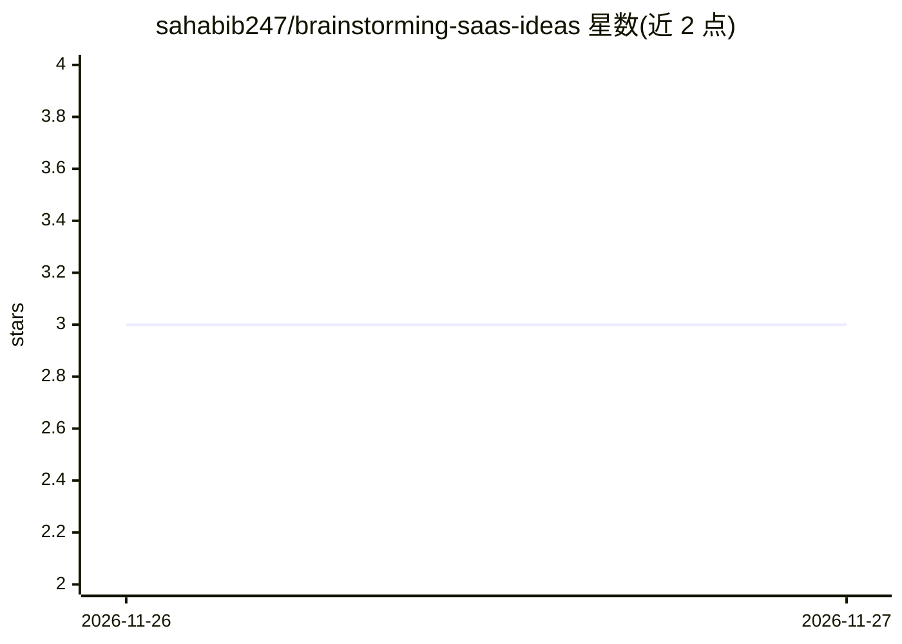

# sahabib247/brainstorming-saas-ideas

⭐ 3 · MIT · 推送 2026-10-28 · [GitHub](https://github.com/sahabib247/brainstorming-saas-ideas) · 个人维护

**面向独立开发者的 Claude 技能：生成去套路化的 SaaS 创意**

一个运行于 Claude 的 SKILL 技能包，用户用自然语言请求后，Claude 依技能提示词执行创意头脑风暴流程：先挖掘 Reddit/HN/应用商店评论等真实痛点并给来源标注，再用原创性引擎与 11 道硬门过滤套路化点子，生成 25+ 个私藏创意后只输出最佳 3 张创意卡（含 ICP、竞品、定价、MVP 范围、7 天验证测试等）。提供 Fresh/Quick/Remix/Direction/Deep dive 五种模式。安装方式为上传 zip 到 Claude Skills 或将 SKILL.md 加入 Claude Projects；建议开启网页搜索以获取实时证据，否则市场声明标记为未验证。

## 筛选速览

| 维度 | 判定 | 备注 |
|---|---|---|
| AI 角色 | `ai-native` | 本体是模型或模型工具 |
| 许可风险 | `permissive` | MIT |
| 部署形态 | `desktop` | 安装包/桌面程序 |
| 模型依赖 | locked-api |  |
| 硬件要求 | — | 无带数字的原话,不猜 |
| 安装摩擦 | `low` | 无编译、无系统依赖或容器化 |
| 成熟度 | — | 结构信号不足 |

## 能力要点

- 原创性引擎以 12 种技法拒绝常见套路点子
- 每个声明带来源，未核实项标记 [assumption]/[unverified]
- 11 道硬门加 11 项评分标准筛选创意
- 输出含定价、单位经济与 7 天验证测试的创意卡

## 适用场景

- 为独立开发项目寻找差异化的 SaaS 点子
- 把自己已有的点子交给 Claude 做批评与变体改写
- 按预算、技能与时间约束筛选可行创意

## 场景标签

`提示工程` `AI 写作` · 领域:Agent 开发

## 证据(README 行号)

> L3: **A free Claude skill that brainstorms unique SaaS & app ideas, not the usual "AI tool for X".**
> L13: This skill makes Claude brainstorm like a sceptical founder instead of a hype machine. It covers **SaaS, web apps, 

## 星数曲线

2026-11-26 3 → 2026-11-27 3（+0）

---
*卡片 v1 · prompt 1.4 · 生成 2026-11-26 · 置信度 high · 依据 README sha `ae9da331a37e` · [字段定义](../../DATASET.md)*
