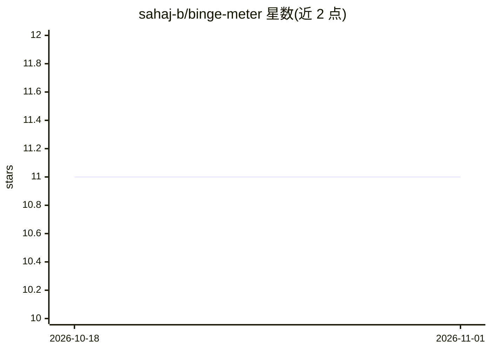

# sahaj-b/binge-meter

⭐ 11 · TypeScript · MIT · 推送 2026-05-21 · [GitHub](https://github.com/sahaj-b/binge-meter) · [官网](https://chromewebstore.google.com/detail/binge-meter/jlbijnlhiaaophloidngjkdfmdopnagh) · 个人维护

**追踪分心网站用时并按需 AI 分类的浏览器扩展**

面向个人用户的浏览器扩展：追踪 YouTube、Reddit、X 等分心网站的停留时间，提供页面上实时计时悬浮层、站点屏蔽（达到每日时限后锁定并可选宽限期）、分析图表与 URL/频道/子版块的手动标记。AI 分类为可选功能，通过 BYOK 方式接入 Google Gemini（默认 Gemini 2.5 Flash Lite），依据页面元数据判定生产性/分心性，并从手动分类与自定义指令中学习。数据本地存储，无云同步；AI 开启时会将页面元数据发送至 Google API。

## 筛选速览

| 维度 | 判定 | 备注 |
|---|---|---|
| AI 角色 | `ai-enhanced` | 去掉 AI 部分产品仍成立 |
| 许可风险 | `permissive` | MIT |
| 部署形态 | `None` |  |
| 模型依赖 | — | README 未给出锁定关系 |
| 硬件要求 | — | 无带数字的原话,不猜 |
| 安装摩擦 | `low` | 无编译、无系统依赖或容器化 |
| 成熟度 | — | 结构信号不足 |

## 能力要点

- 实时悬浮计时层与达到时限后的站点屏蔽（含宽限期）
- 可选的 Gemini 页面分类，从手动标记与自定义指令中学习
- 按 URL/YouTube 频道/子版块的手动标记与例外规则
- 数据全部本地存储，无云同步

## 适用场景

- 看清自己在哪些网站浪费了多少时间
- 达到每日时限后自动锁定分心网站
- 用 AI 自动区分同一站点上的生产性与分心内容

## 场景标签

 · 领域:个人效率/浏览器扩展

## 证据(README 行号)

> L24: Tired of falling down rabbit holes on YouTube, Reddit, or X and wondering where the hell your day went? **Binge Met
> L119: **A:** The AI is **100% optional**. The extension works perfectly fine as a manual time tracker without it. Google

## 星数曲线

2026-10-18 11 → 2026-11-01 11（+0）

---
*卡片 v1 · prompt 1.4 · 生成 2026-11-01 · 置信度 high · 依据 README sha `892ae7f1a200` · [字段定义](../../DATASET.md)*
