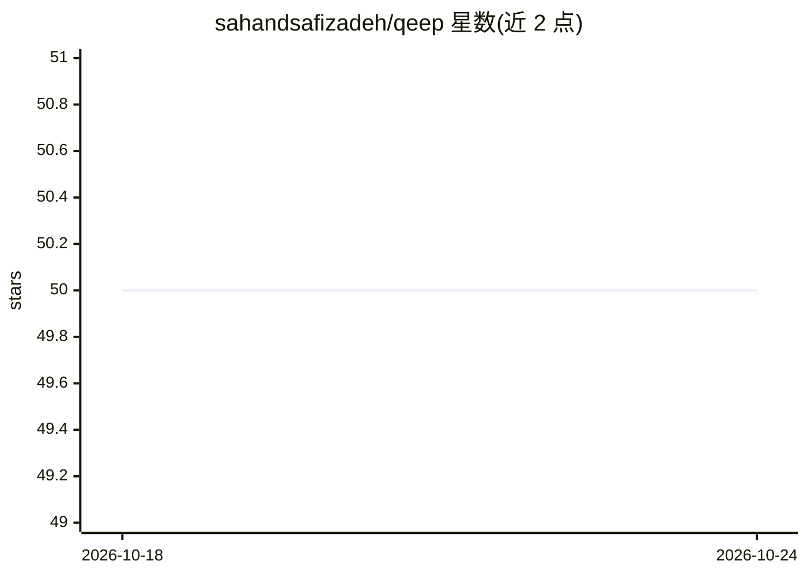

# sahandsafizadeh/qeep

⭐ 50 · Go · MIT · 推送 2026-10-07 · [GitHub](https://github.com/sahandsafizadeh/qeep) · 个人维护

**Go 语言深度学习框架：张量、自动微分与 CUDA 加速**

用 Go 实现的深度学习框架，提供多维张量及线性代数/统计运算、基于张量的自动微分（AutoGrad）、经 CUDA 的 GPU 加速，以及 FC/BatchNorm/Dropout 等神经网络组件。通过 stream 包以声明式 API 定义网络模型。安装方式为克隆仓库并用 Go modules 关联本地包；GPU 运行需 CUDA-capable GPU、CUDA Toolkit、C 工具链与 CGO。附 MNIST 等可运行示例。

## 筛选速览

| 维度 | 判定 | 备注 |
|---|---|---|
| AI 角色 | `ai-ecosystem` | LLM/agent 周边工具 |
| 许可风险 | `permissive` | MIT |
| 部署形态 | `library` | 以包/库形式分发 |
| 模型依赖 | — | README 未给出锁定关系 |
| 硬件要求 | — | 无带数字的原话,不猜 |
| 安装摩擦 | `medium` | 含编译或系统依赖之一 |
| 成熟度 | — | 结构信号不足 |

## 能力要点

- 多维张量与线性代数/统计运算
- 张量级自动微分（AutoGrad）
- 经 CUDA 的 GPU 加速（make cuda + cuda 构建标签）
- 声明式 API（stream 包）定义神经网络

## 适用场景

- 在 Go 项目中定义与训练神经网络模型
- 在张量级别控制运算的深度学习开发
- 利用 CUDA GPU 运行计算任务

## 场景标签

`模型训练` · 领域:训练与推理

## 证据(README 行号)

> L3: Welcome to **qeep** (pronounced /kēp/)! This project implements a **deep learning framework** in **_Go_**. It allows
> L9: - ⚡ _GPU acceleration_ via **CUDA** for high-performance computations.

## 星数曲线

2026-10-18 50 → 2026-10-24 50（+0）

---
*卡片 v1 · prompt 1.4 · 生成 2026-10-24 · 置信度 high · 依据 README sha `c9f2201b39bf` · [字段定义](../../DATASET.md)*
