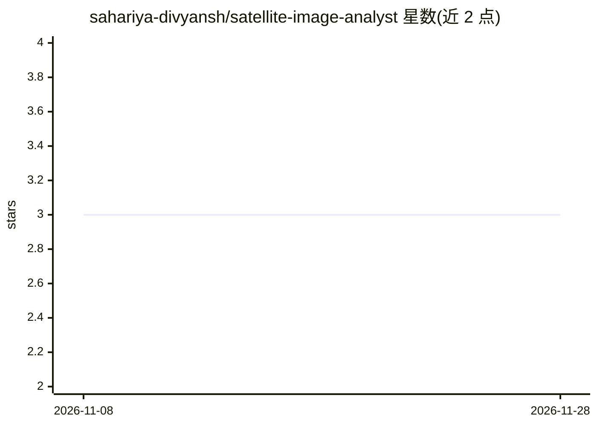

# sahariya-divyansh/satellite-image-analyst

⭐ 3 · Python · MIT · 推送 2026-11-03 · [GitHub](https://github.com/sahariya-divyansh/satellite-image-analyst) · 个人维护

**自然语言查询 Sentinel-2 卫星影像的水体变化分析工具**

将自然语言地球观测问题编译为验证过的分析计划，由确定性 Sentinel-2 流水线（xarray/rioxarray/rasterio/geopandas）计算水体面积与变化，verifier 校验报告中的数值与计算结果一致。默认使用规则式规划器，可切换 LLM 模式（Gemini/OpenAI/Ollama），LLM 仅作为查询编译器与受限叙述生成器。基于 MNDWI 指数、同季节合成与 BOA 偏移校正，输出变更分类与敏感性范围。提供 FastAPI REST 接口、Web 界面、CLI 与离线演示模式，数据来自 Microsoft Planetary Computer STAC。

## 筛选速览

| 维度 | 判定 | 备注 |
|---|---|---|
| AI 角色 | `ai-native` | 本体是模型或模型工具 |
| 许可风险 | `permissive` | MIT |
| 部署形态 | `self-host` | docker 或自建部署 |
| 模型依赖 | local-ok | 支持本地模型 |
| 硬件要求 | — | 无带数字的原话,不猜 |
| 安装摩擦 | `low` | 无编译、无系统依赖或容器化 |
| 成熟度 | — | 结构信号不足 |

## 能力要点

- LLM 输出数值经 Grounding Verifier 对照确定性流水线校验
- 默认规则式规划器零 API key、零 GPU 依赖，支持 LLM 模式切换
- MNDWI 水体指数 + BOA 偏移校正 + 同季节合成的完整遥感流水线
- 含 held-out 基准与 JRC Global Surface Water 对照评估数据

## 适用场景

-  municipal planner 评估水库面积变化趋势
- 环境研究者查询某区域 2023-2025 水体扩张
- 非 GIS 专业用户用自然语言获取地表水清单
- 需要可复现数值的遥感变化检测报告

## 场景标签

`数据分析` `科研工具` · 领域:效率与自动化

## 证据(README 行号)

> L12: Ask a question like 'Show water bodies that expanded near Raipur between 2023 and 2025'. A planner compiles it into
> L25: Earth-observation imagery contains petabytes of planetary data, yet non-expert analysts, municipal planners, and en
> L29: 2. **100% of numbers, raster band mathematics, cloud masking, spatial reprojections, and acreage statistics are com

## 星数曲线

2026-11-08 3 → 2026-11-28 3（+0）

---
*卡片 v1 · prompt 1.4 · 生成 2026-11-21 · 置信度 high · 依据 README sha `48e27cf3d673` · [字段定义](../../DATASET.md)*
