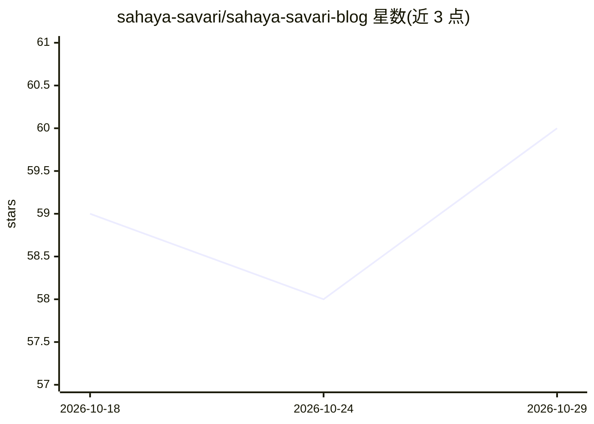

# sahaya-savari/sahaya-savari-blog

⭐ 60 · TypeScript · MIT · 推送 2026-09-12 · [GitHub](https://github.com/sahaya-savari/sahaya-savari-blog) · [官网](https://blog.sahayasavari.dev) · 个人维护

**个人技术博客与作品集网站（React/Vite 静态站）**

基于 React 18、Vite 5、TypeScript、Tailwind CSS 与 Framer Motion 构建的个人博客及作品集网站，主题涵盖 AI、Python、机器学习与软件工程教程。功能包括客户端搜索与分类过滤、Markdown 渲染与目录生成、PWA 离线缓存、SPA 路由（适配 GitHub Pages）及 SEO 配置。通过 GitHub Actions 工作流自动部署至 GitHub Pages 自定义域名，代码以 MIT 许可发布，文章内容保留版权。

## 筛选速览

| 维度 | 判定 | 备注 |
|---|---|---|
| AI 角色 | `ai-knowledge` | 知识聚合/清单类 |
| 许可风险 | `permissive` | MIT |
| 部署形态 | `None` |  |
| 模型依赖 | — | README 未给出锁定关系 |
| 硬件要求 | — | 无带数字的原话,不猜 |
| 安装摩擦 | `low` | 无编译、无系统依赖或容器化 |
| 成熟度 | — | 结构信号不足 |

## 能力要点

- 客户端动态搜索、分类过滤与分页
- 自定义 Markdown-to-JSX 渲染与目录（TOC）生成
- Service Worker / PWA 离线缓存
- GitHub Actions 自动部署至 GitHub Pages 自定义域名

## 适用场景

- 发布和浏览 AI、Python、机器学习方向的教程与项目文章
- 作为开发者个人作品集与博客站点模板参考
- 在 GitHub Pages 上托管支持离线访问的静态博客

## 场景标签

`教程课程` · 领域:学习与行业

## 证据(README 行号)

> L1: # Sahaya Savari — Python, Git & AI Blog
> L3: A high-performance, responsive personal learning blog and professional portfolio website built using React, Vite, Ty

## 星数曲线

2026-10-18 59 → 2026-10-29 60（+1）

---
*卡片 v1 · prompt 1.4 · 生成 2026-10-24 · 置信度 mid · 依据 README sha `68df97e98481` · [字段定义](../../DATASET.md)*
