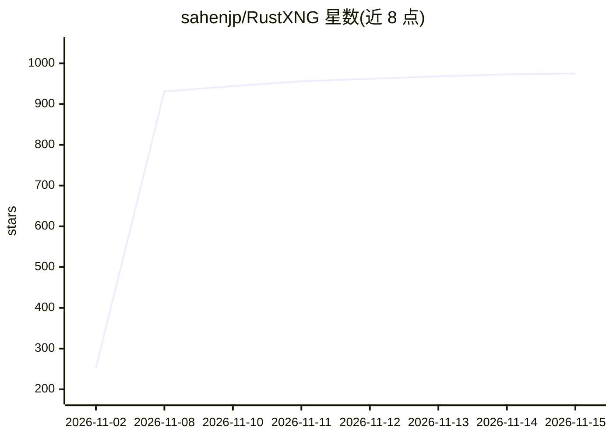

# sahenjp/RustXNG

⭐ — · [GitHub]() · 个人维护

**面向本地 AI agent 的自托管元搜索与溯源引擎**

用 Rust 实现的 SearXNG 移植版：单次请求返回排序结果与前 5 页约 32,000 字符的页面文本，供 agent 基于来源作答。无 API key、自托管，搜索词不离开本机。移植 226 种引擎类型、默认启用 180 个并行引擎，含逐引擎超时/熔断/恢复、SSRF 防护（仅公网地址）、响应缓存与 OpenMetrics 监控。可选本地索引（爬取自有语料 + BM25 合并），实验性且默认关闭。提供预编译二进制、Cargo、Docker 与源码安装；需 Rust 1.85+。AGPL-3.0 许可。

## 筛选速览

| 维度 | 判定 | 备注 |
|---|---|---|
| AI 角色 | `ai-ecosystem` | LLM/agent 周边工具 |
| 许可风险 | `viral` | — |
| 部署形态 | `self-host` | docker 或自建部署 |
| 模型依赖 | — | README 未给出锁定关系 |
| 硬件要求 | — | 无带数字的原话,不猜 |
| 安装摩擦 | `low` | 无编译、无系统依赖或容器化 |
| 成熟度 | — | 结构信号不足 |

## 能力要点

- 单请求返回排序结果 + 约 32,000 字符页面文本
- 移植 SearXNG 的 226 种引擎类型，默认并行启用 180 个
- SSRF 防护：仅访问公网地址
- 可选实验性本地索引（爬取 + BM25 合并结果）

## 适用场景

- 为本地 LLM agent 提供免 key 的联网检索与接地文本
- 在自有网络内自托管搜索层，搜索词不出网
- 为 agent 回答提供可引用的页面原文来源

## 场景标签

`网页抓取` · 领域:效率与自动化

## 证据(README 行号)

> L3: **A self-hosted, SSRF-hardened web search and grounding engine for local AI agents.**
> L15: An agent searches, reads, and decides — then does it again. What it needs underneath is not another search UI but a
> L119: |docs/AI-INFRA.md|Why this is agent infrastructure, and why tests and audits matter|

## 星数曲线

2026-11-02 252 → 2026-11-15 975（+723）

---
*卡片 v1 · prompt 1.4 · 生成 2026-11-02 · 置信度 high · 依据 README sha `4583190475dd` · [字段定义](../../DATASET.md)*
