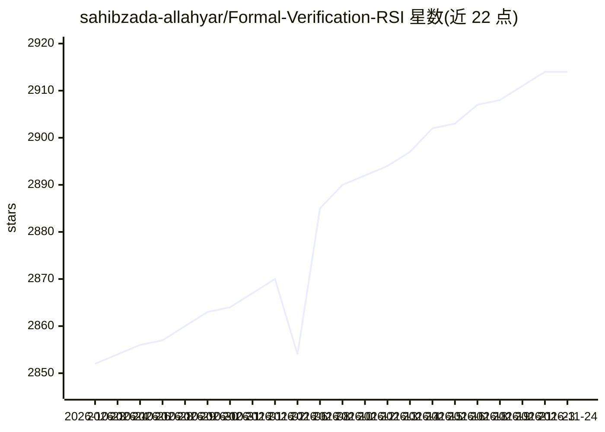

# sahibzada-allahyar/Formal-Verification-RSI

⭐ 2,914 · Python · MIT · 推送 2026-10-22 · [GitHub](https://github.com/sahibzada-allahyar/Formal-Verification-RSI) · [官网](https://sahibzada-allahyar.github.io) · 个人维护

**为 coding agent 提供防作弊形式化验证门与可验证自我改进循环**

由 Millennium Harness（Lean 4 / Dafny 证明检查器）与 Millennium RSI（自我改进 agent 循环）组成：前者以冻结规格、公理白名单、内核重放、dafny audit 等机制拒绝含 sorry、assume {:axiom}、实例篡改等作弊手段的假证明；后者把 harness 作为数据，improver 模型改写 harness，新引理须通过内核检查才能入库，以 held-out 证明数为不可被操纵的奖励。用于审计已发布基准中的假证明与在 agent 循环中作为停止门。需 Python 3.10+ 与 elan 安装的 Lean、Dafny 工具链，模型调用需 API key。

## 筛选速览

| 维度 | 判定 | 备注 |
|---|---|---|
| AI 角色 | `ai-ecosystem` | LLM/agent 周边工具 |
| 许可风险 | `permissive` | MIT |
| 部署形态 | `library` | 以包/库形式分发 |
| 模型依赖 | — | README 未给出锁定关系 |
| 硬件要求 | — | 无带数字的原话,不猜 |
| 安装摩擦 | `low` | 无编译、无系统依赖或容器化 |
| 成熟度 | — | 结构信号不足 |

## 能力要点

- 模型无关的证明检查门：冻结规格核验、公理白名单、内核重放
- 红队套件含 96 种作弊样例，检查器全部拒绝且接受全部诚实解
- RSI 循环中新引理须独立编译、无禁用结构、仅依赖标准公理方可入库
- 提供 --reward exit0 消融模式，对比 exit-code 奖励下被接受的假证明数

## 适用场景

- 审计形式化编码基准中被标记为已验证的 AI 解答是否为假证明
- 在 OpenCode/Claude Code agent 循环中作为不可作弊的停止条件
- 构建奖励不可被操纵的自我改进实验

## 场景标签

`编码 Agent` `模型评测` · 领域:编码与开发

## 证据(README 行号)

> L35: **Millennium Harness** is a model-free gate: a solution counts only if the frozen specification kept its meaning an
> L84: Millennium RSI is an agent that improves its own harness, and keeps a change only if Millennium Harness certifies m
> L171: **Agents** · `bench/agents_fv.py` runs OpenCode or Claude Code with the gate in a sandbox; when the

## 星数曲线

2026-10-23 2,852 → 2026-11-24 2,914（+62）

---
*卡片 v1 · prompt 1.4 · 生成 2026-11-23 · 置信度 high · 依据 README sha `46fbe3f7550a` · [字段定义](../../DATASET.md)*
