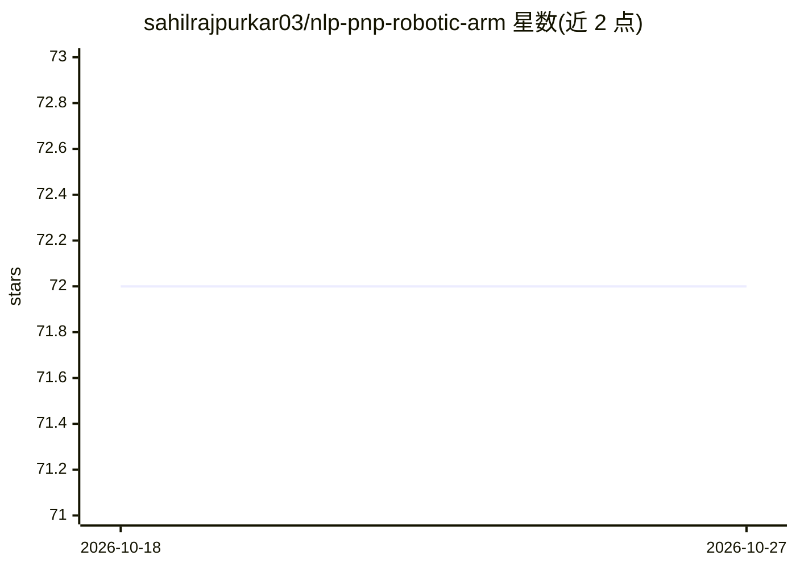

# sahilrajpurkar03/nlp-pnp-robotic-arm

⭐ 72 · Python · 推送 2026-07-06 · [GitHub](https://github.com/sahilrajpurkar03/nlp-pnp-robotic-arm) · 个人维护

**自然语言控制的 ROS2 抓放机器人系统（仿真）**

基于 ROS2 Humble 的智能抓放（pick-and-place）机器人系统，运行于 Isaac Sim 仿真环境：YOLOv8-OBB 做实时旋转框目标检测，MoveIt 做运动规划，支持 Franka Panda 与 UR5 机械臂。集成 Ollama 驱动的聊天机器人界面，用户可用英文自然语言向机器人下达指令。运行需要 ROS2 Humble、MoveIt、Isaac Sim、Conda 环境与 Ollama。

## 筛选速览

| 维度 | 判定 | 备注 |
|---|---|---|
| AI 角色 | `ai-ecosystem` | LLM/agent 周边工具 |
| 许可风险 | `none` | — |
| 部署形态 | `library` | 以包/库形式分发 |
| 模型依赖 | local-ok | 支持本地模型 |
| 硬件要求 | — | 无带数字的原话,不猜 |
| 安装摩擦 | `low` | 无编译、无系统依赖或容器化 |
| 成熟度 | — | 结构信号不足 |

## 能力要点

- YOLOv8-OBB 旋转框实时目标检测
- MoveIt 运动规划，兼容 Franka Panda 与 UR5 双臂配置
- Ollama 驱动的自然语言聊天机器人控制接口
- Isaac Sim 仿真中提取相机内参（fx, fy, cx, cy）

## 适用场景

- 在 Isaac Sim 仿真中用英文指令控制机械臂完成抓放任务
- 复现感知（检测）→规划（MoveIt）→执行的机械臂操作流程
- 机器人课程或竞赛项目中演示自然语言人机交互

## 场景标签

`目标检测` · 领域:感知与多模态

## 证据(README 行号)

> L12: SPARC is an intelligent **pick-and-place robotic system** built on **ROS2 Humble**, **Isaac Sim**, and **MoveIt**. 
> L15: - **Chatbot interface** powered by **Ollama LLMs** for natural language control
> L22: - 🧠 Natural language chatbot interface (Ollama)

## 星数曲线

2026-10-18 72 → 2026-10-27 72（+0）

---
*卡片 v1 · prompt 1.4 · 生成 2026-10-24 · 置信度 low · 依据 README sha `1efa0dd9db4f` · [字段定义](../../DATASET.md)*
