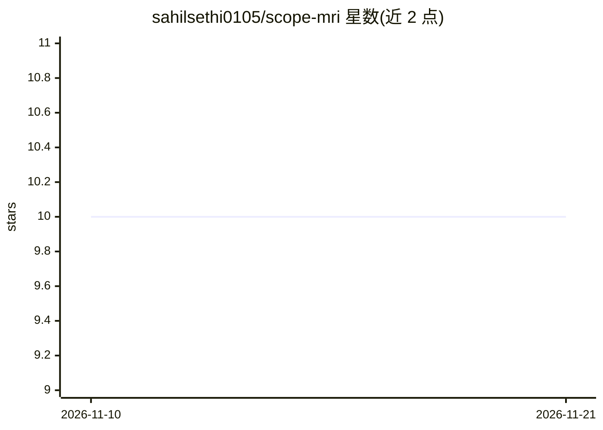

# sahilsethi0105/scope-mri

⭐ 10 · Jupyter Notebook · MIT · 推送 2025-12-22 · [GitHub](https://github.com/sahilsethi0105/scope-mri) · [官网](https://www.nature.com/articles/s44387-025-00043-5) · 组织维护

**肩部 MRI 影像数据集配套的深度学习入门代码库**

随 SCOPE-MRI 肩部 MRI 数据集与论文（NPJ Artificial Intelligence 2025）发布的代码库，提供从 DICOM 原始文件到预处理数据集的转换脚本、训练/超参调优/交叉验证/集成脚本，以及 Grad-CAM 可视化。代码设计为单 GPU 训练，手动实现检查点、Optuna 集成与 TensorBoard 日志；兼容 Stanford MRNet 膝关节 MRI 数据集，也可适配自定义二分类任务。SCOPE-MRI 数据通过 MIDRC 获取，面向政府与学术研究者免费非商业使用。

## 筛选速览

| 维度 | 判定 | 备注 |
|---|---|---|
| AI 角色 | `ai-knowledge` | 知识聚合/清单类 |
| 许可风险 | `permissive` | MIT |
| 部署形态 | `None` |  |
| 模型依赖 | — | README 未给出锁定关系 |
| 硬件要求 | — | 无带数字的原话,不猜 |
| 安装摩擦 | `low` | 无编译、无系统依赖或容器化 |
| 成熟度 | — | 结构信号不足 |

## 能力要点

- 配套公开 SCOPE-MRI 肩部 MRI 数据集（MIDRC 平台获取）
- 支持训练、超参调优、交叉验证与多视图模型集成
- Grad-CAM 热图输出模型关注区域
- 兼容 Stanford MRNet 数据集，可适配自定义 DICOM 数据

## 适用场景

- 医学影像深度学习入门实践
- 训练肩部 Bankart 损伤检测等二分类模型
- 将自己的 MRI/CT 数据接入训练流程
- 用 Grad-CAM 分析模型对影像的关注区域

## 场景标签

`模型训练` · 领域:训练与推理

## 证据(README 行号)

> L2: This repository is meant to be a useful resource for getting started with using deep learning on MRIs and CT scans. 
> L12: Although the repo was developed for the above papers, we have written the code so that it can be easily adapted for

## 星数曲线

2026-11-10 10 → 2026-11-21 10（+0）

---
*卡片 v1 · prompt 1.4 · 生成 2026-11-19 · 置信度 high · 依据 README sha `89e1bdcec5c6` · [字段定义](../../DATASET.md)*
