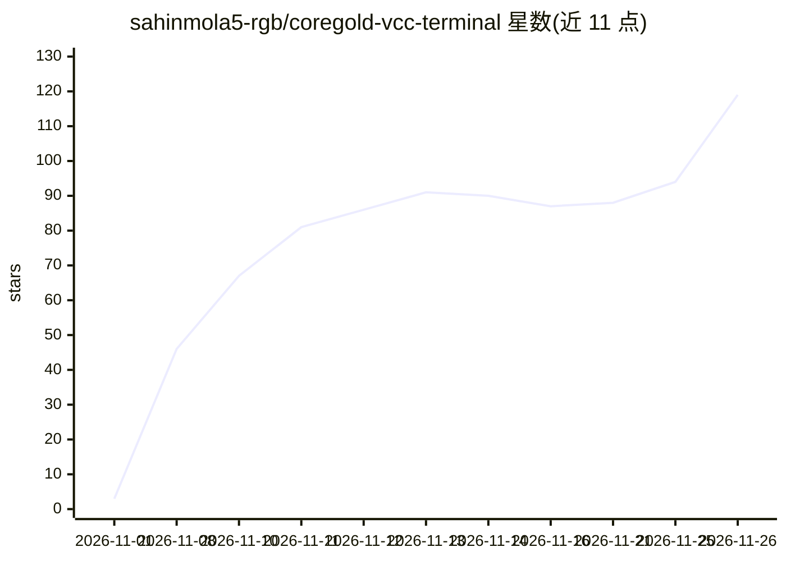

# sahinmola5-rgb/coregold-vcc-terminal

⭐ 119 · 推送 2026-10-31 · [GitHub](https://github.com/sahinmola5-rgb/coregold-vcc-terminal) · [官网](https://app.coregold.io/signup?invite_code=ADvlj9b) · 组织维护 · 中文 README

**海外软件/AI 订阅用的虚拟信用卡开卡服务推广页**

该仓库 README 是 CoreGold 虚拟卡服务的推广文案，非软件代码项目。宣称的功能：生成独立海外 Visa/Mastercard 虚拟卡，单卡额度精确到分以阻断超额扣费，一号一卡隔离风险，支持 AVS 账单对齐用于绑定 OpenAI、Midjourney、Figma 等平台，销卡后余额退回母账户，出入金通过 USDT 链上进行。仓库本身不含可安装运行的程序，仅提供注册入口链接与一段十六进制字符串，无 API 文档或代码说明，主题标签含 api、openai 但正文未给出技术接入方式。

## 筛选速览

| 维度 | 判定 | 备注 |
|---|---|---|
| AI 角色 | `ai-enhanced` | 去掉 AI 部分产品仍成立 |
| 许可风险 | `none` | — |
| 部署形态 | `None` |  |
| 模型依赖 | — | README 未给出锁定关系 |
| 硬件要求 | — | 无带数字的原话,不猜 |
| 安装摩擦 | `low` | 无编译、无系统依赖或容器化 |
| 成熟度 | — | 结构信号不足 |

## 能力要点

- 单卡额度精确到分，超出预设额度即拒付的扣费熔断机制
- 欧美企业级 Commercial BIN 与真实 AVS 账单对齐，用于海外 SaaS 绑卡
- 销卡后余额退回母账户，USDT 链上出入金

## 适用场景

- 订阅海外 AI 工具或 SaaS 时用限额虚拟卡防止自动续费超扣
- 为不同平台分配独立卡号，隔离拖库泄密风险
- 试用结束后通过销卡代替寻找退订入口

## 场景标签

 · 领域:金融支付/订阅管理

## 证据(README 行号)

> L5: > 用 **CoreGold** 生成独立的海外 Visa / Mastercard 虚拟卡，额度精确到分，用完一键注销，把扣费主动权死死攥在自己手里。
> L12: - **免密试用 $0 验资秒过**：精选欧美企业级 Commercial BIN，支持真实 AVS 账单对齐，OpenAI、Midjourney、Figma 绑卡不卡单。

## 星数曲线

2026-11-01 3 → 2026-11-26 119（+116）

---
*卡片 v1 · prompt 1.4 · 生成 2026-11-17 · 置信度 low · 依据 README sha `1e318ce40e03` · [字段定义](../../DATASET.md)*
