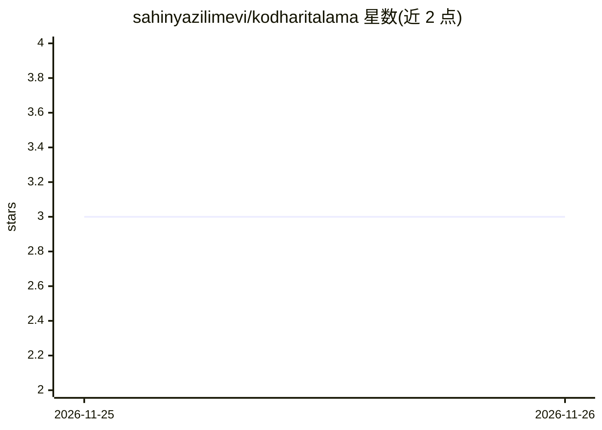

# sahinyazilimevi/kodharitalama

⭐ 3 · Python · Apache-2.0 · 推送 2026-11-04 · [GitHub](https://github.com/sahinyazilimevi/kodharitalama) · 个人维护

**为编码 Agent 生成本地可查询的代码知识图谱**

将源码、文档、图片、视频等文件夹构建为持久化知识图谱，输出 god nodes、社区结构、跨文件关系、架构摘要，以及交互式 HTML、GraphRAG JSON、GRAPH_REPORT.md。编码 Agent 通过范围化问题获取小子图而非 grep 全库。支持 AST 增量更新、MCP 服务、Neo4j/FalkorDB/Obsidian 等可选导出。安全上默认拒绝 URL 抓取、无遥测、依赖锁定。Python 3.10–3.13 运行，从源码 checkout 安装。

## 筛选速览

| 维度 | 判定 | 备注 |
|---|---|---|
| AI 角色 | `ai-ecosystem` | LLM/agent 周边工具 |
| 许可风险 | `permissive` | Apache-2.0 |
| 部署形态 | `library` | 以包/库形式分发 |
| 模型依赖 | — | README 未给出锁定关系 |
| 硬件要求 | — | 无带数字的原话,不猜 |
| 安装摩擦 | `low` | 无编译、无系统依赖或容器化 |
| 成熟度 | — | 结构信号不足 |

## 能力要点

- 将仓库转为可查询知识图谱，Agent 提问返回小子图
- 45+ 语言，AST-only 增量更新不调用 LLM
- 为 Claude Code/OpenCode/Antigravity 一键安装项目本地技能
- 安全加固：无遥测、默认拒绝抓取、路径限制、锁定依赖

## 适用场景

- 让编码 Agent 在大仓库中做范围化检索而非 grep
- 生成架构摘要与跨文件关系报告供阅读
- 通过 MCP 将代码图接入 IDE Agent 工作流

## 场景标签

`编码 Agent` `知识图谱` · 领域:编码与开发

## 证据(README 行号)

> L3: Local, security-hardened code knowledge graph for **Claude Code**, **OpenCode**,
> L17: `kodharitalama` turns a folder of source code, documents, papers, images, or
> L25: For coding agents, the important part is retrieval: instead of grepping a large

## 星数曲线

2026-11-25 3 → 2026-11-26 3（+0）

---
*卡片 v1 · prompt 1.4 · 生成 2026-11-24 · 置信度 mid · 依据 README sha `5cb41d456bb6` · [字段定义](../../DATASET.md)*
