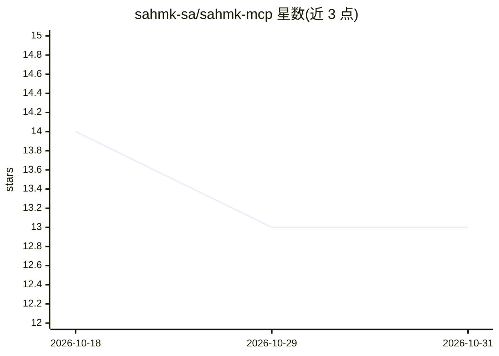

# sahmk-sa/sahmk-mcp

⭐ 13 · Python · MIT · 推送 2026-08-25 · [GitHub](https://github.com/sahmk-sa/sahmk-mcp) · [官网](https://sahmk.sa/developers) · 组织维护

**让 AI agent 查询沙特股市数据的 MCP 服务器**

SAHMK 官方发布的 Model Context Protocol 服务器，把沙特市场（TASI/NOMU）行情数据以工具形式暴露给 Cursor、Claude Desktop 等 AI 客户端：提供个股/批量报价、公司目录、市场摘要与涨跌榜、板块表现、财报、比率对比、分红、盘口深度、逐笔成交与历史 OHLCV 共 15 个工具。标识符解析由后端 SDK 完成，支持阿拉伯语/英语名称。需 SAHMK_API_KEY，部分工具按订阅计划（Starter/Pro）与权限门控。pip 安装，MIT 许可。

## 筛选速览

| 维度 | 判定 | 备注 |
|---|---|---|
| AI 角色 | `ai-ecosystem` | LLM/agent 周边工具 |
| 许可风险 | `permissive` | MIT |
| 部署形态 | `library` | 以包/库形式分发 |
| 模型依赖 | — | README 未给出锁定关系 |
| 硬件要求 | — | 无带数字的原话,不猜 |
| 安装摩擦 | `low` | 无编译、无系统依赖或容器化 |
| 成熟度 | — | 结构信号不足 |

## 能力要点

- 15 个工具覆盖报价、财报、盘口深度、逐笔成交与历史数据
- 标识符支持数字代码、阿拉伯语/英语公司名与别名，歧义返回候选
- 提供 Claude Desktop 与 Cursor 的 MCP 配置示例及直接 CLI 运行方式
- 部分工具按订阅计划门控（Starter/Pro），错误透传底层 API

## 适用场景

- 在 Cursor 或 Claude Desktop 里用自然语言查询沙特股价和市场摘要
- 让 AI 助手对比多只沙特股票的指标与板块表现
- 通过 companies_list 先发现股票代码再查财报和历史行情

## 场景标签

`金融量化` · 领域:学习与行业

## 证据(README 行号)

> L7: Official SAHMK MCP server for SAHMK — use Saudi market data inside AI agents such as Cursor and Claude Desktop.
> L9: This MCP exposes a curated set of Sahmk tools for AI agents, so assistants can query the Saudi market in natural lan
> L40: - Use **MCP** for interactive agent workflows in tools like Cursor and Claude Desktop.

## 星数曲线

2026-10-18 14 → 2026-10-31 13（-1）

---
*卡片 v1 · prompt 1.4 · 生成 2026-10-31 · 置信度 high · 依据 README sha `ae49aeef14c2` · [字段定义](../../DATASET.md)*
