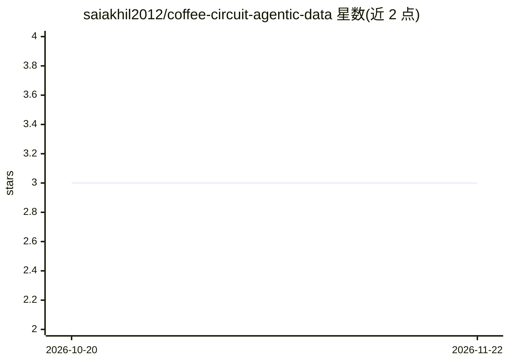

# saiakhil2012/coffee-circuit-agentic-data

⭐ — · [GitHub]() · 个人维护

**单机可运行的 AI 代理数据架构参考实现：混合检索+RAG+MCP+人工审批写入**

以虚构咖啡连锁的质量投诉场景为例，演示一套面向 AI 代理的数据架构：写入时生成嵌入、SQL++ 单查询实现关键词过滤+语义排序的混合检索、带来源引用的 RAG、基于文档 ID 关系的供应链追溯、经只读 Couchbase MCP 服务器读取数据，写入则通过需人工审批的单一工具执行 ACID 事务并由 n8n 发邮件通知。全部组件自托管于一台笔记本，Docker 启动，离线运行，无需云服务或 API key。适合想参考代理数据架构模式的开发者。

## 筛选速览

| 维度 | 判定 | 备注 |
|---|---|---|
| AI 角色 | `ai-native` | 本体是模型或模型工具 |
| 许可风险 | `permissive` | — |
| 部署形态 | `None` |  |
| 模型依赖 | local-ok | 支持本地模型 |
| 硬件要求 | — | 无带数字的原话,不猜 |
| 安装摩擦 | `low` | 无编译、无系统依赖或容器化 |
| 成熟度 | — | 结构信号不足 |

## 能力要点

- 关键词过滤+语义排序的混合检索，SQL++ 单查询实现
- 只读路径走 Couchbase MCP 服务器，写入需人工审批并整体提交或回滚
- RAG 回答附带质量流程来源引用
- 自托管 n8n 自动化邮件流程，离线运行无需 API key

## 适用场景

- 参考如何为 AI 代理设计带审批的读写分离数据架构
- 在本地离线环境搭建混合检索与 RAG 示例
- 学习通过 MCP 服务器让代理安全访问数据库

## 场景标签

`RAG` · 领域:知识与检索

## 证据(README 行号)

> L3: **A runnable reference implementation of a data architecture for AI agents.**
> L17: - **RAG with sources:** answers cite the quality procedure they came from.

## 星数曲线

2026-10-20 3 → 2026-11-22 3（+0）

---
*卡片 v1 · prompt 1.4 · 生成 2026-11-21 · 置信度 mid · 依据 README sha `68d96ae10ff4` · [字段定义](../../DATASET.md)*
