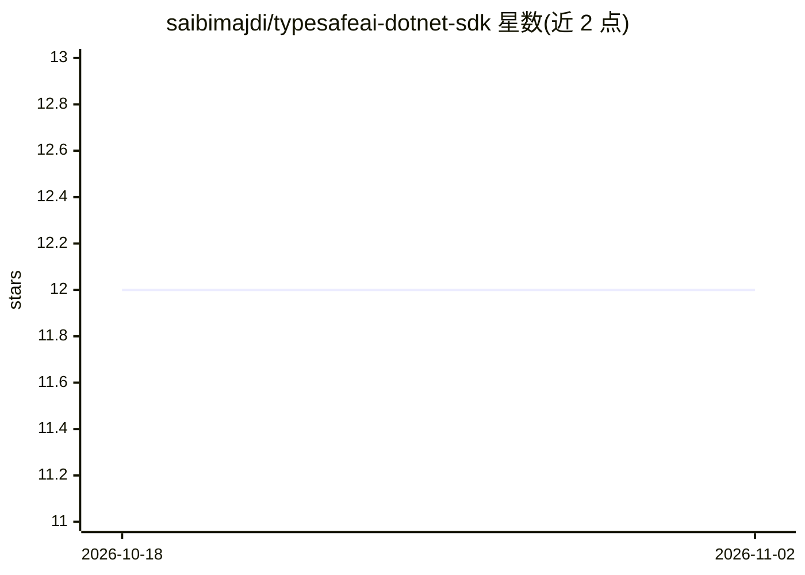

# saibimajdi/typesafeai-dotnet-sdk

⭐ 12 · C# · MIT · 推送 2026-10-29 · [GitHub](https://github.com/saibimajdi/typesafeai-dotnet-sdk) · [官网](https://saibimajdi.github.io/typesafeai-dotnet-sdk/) · 个人维护

**TypeSafe AI System One API 的社区 .NET 客户端 SDK**

面向 .NET 8/.NET 10 开发者的社区维护 SDK，封装 TypeSafe AI System One HTTP API：以强类型方式声明 noul（是/否概率）、choice（多选一）、score（量表定位）与实验性 box（图像定位）问题，返回带置信度与完整概率分布的结构化答案。库内实现重试、退避、Retry-After 与单次超时，核心包仅依赖一个包；支持 DI 注册、trim/AOT，未知字段与新答案类型经 RawJson/UnknownAnswer 保留以保持前向兼容。需 TYPESAFE_API_KEY，仅发布 prerelease 版本。项目声明与 TypeSafe AI 无隶属关系。

## 筛选速览

| 维度 | 判定 | 备注 |
|---|---|---|
| AI 角色 | `ai-ecosystem` | LLM/agent 周边工具 |
| 许可风险 | `permissive` | MIT |
| 部署形态 | `None` |  |
| 模型依赖 | — | README 未给出锁定关系 |
| 硬件要求 | — | 无带数字的原话,不猜 |
| 安装摩擦 | `medium` | 含编译或系统依赖之一 |
| 成熟度 | `idea` | |

## 能力要点

- noul/choice/score/box 四种类型化问题与含置信度、概率分布的答案
- 内置重试、退避、Retry-After 与单次超时，核心包仅依赖 Microsoft.Extensions.Logging.Abstractions
- RawJson/RawQuestion/UnknownAnswer 保留未建模字段，前向兼容
- 提供 CompositeScore、NormalizedEntropy 等统计组合工具与 DI 包

## 适用场景

- 在 .NET 应用中调用 TypeSafe AI API 做分类、判定与量表评分
- 置信度门控路由与扇出式多问题批量判定
- 多语言部署中共用同一组 TYPESAFE_* 环境变量配置

## 场景标签

 · 领域:LLM 基础设施/API SDK

## 证据(README 行号)

> L13: This is a community SDK. It is an independent client for the TypeSafe AI System One HTTP API,
> L52: dotnet add package TypeSafeAI.Sdk --prerelease

## 星数曲线

2026-10-18 12 → 2026-11-02 12（+0）

---
*卡片 v1 · prompt 1.4 · 生成 2026-11-01 · 置信度 high · 依据 README sha `0a768144b612` · [字段定义](../../DATASET.md)*
