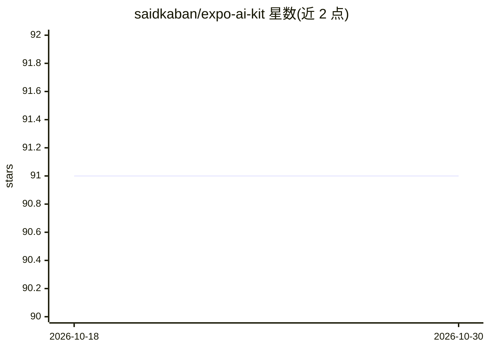

# saidkaban/expo-ai-kit

⭐ 91 · TypeScript · MIT · 推送 2026-09-19 · [GitHub](https://github.com/saidkaban/expo-ai-kit) · [官网](https://expo-ai-kit.dev) · 个人维护

**React Native 端侧 AI 库：本地 LLM、语音转写、视觉与嵌入**

面向 Expo 与 React Native 应用的端侧 AI 模块库，用统一 TypeScript API 封装 iOS 的 Apple Foundation Models/Speech/Vision 与 Android 的 ML Kit/MediaPipe，并通过 LiteRT-LM 运行 Gemma、Qwen、Phi 等可下载模型。功能全部默认关闭，按需编译进原生构建，未启用功能的原生代码、模型与权限不进入包。推理在设备本地完成，无需 API key 与云端；不支持 Expo Go，需 Expo SDK 54+ 与原生构建。

## 筛选速览

| 维度 | 判定 | 备注 |
|---|---|---|
| AI 角色 | `ai-ecosystem` | LLM/agent 周边工具 |
| 许可风险 | `permissive` | MIT |
| 部署形态 | `library` | 以包/库形式分发 |
| 模型依赖 | — | README 未给出锁定关系 |
| 硬件要求 | — | 无带数字的原话,不猜 |
| 安装摩擦 | `low` | 无编译、无系统依赖或容器化 |
| 成熟度 | — | 结构信号不足 |

## 能力要点

- 双平台统一 TypeScript API（iOS 系统框架 / Android ML Kit + MediaPipe）
- LiteRT-LM 支持 Gemma、Qwen、Phi 等可下载模型的文本生成、流式输出与工具调用
- 功能全部 opt-in，未启用的原生代码、模型与权限不进入构建
- 提供语音转写、背景移除、图像标注、OCR、人脸检测与文本嵌入/向量存储

## 适用场景

- 在移动应用中离线运行 LLM 对话与结构化输出，不经过云端
- 为应用添加设备端语音转写或图像识别能力
- 在端侧做语义搜索：文本嵌入、分块与向量存储

## 场景标签

`语音识别` `OCR` `语义搜索` `人脸识别` · 领域:知识与检索

## 证据(README 行号)

> L8: **On-device AI for React Native.** Local LLM, speech-to-text, vision, and embeddings for Expo
> L16: - **One TypeScript API for both platforms.** Apple Foundation Models, Speech, and Vision on iOS;
> L17:  ML Kit and MediaPipe on Android; LiteRT-LM for downloadable models such as Gemma, Qwen, and Phi.

## 星数曲线

2026-10-18 91 → 2026-10-30 91（+0）

---
*卡片 v1 · prompt 1.4 · 生成 2026-10-23 · 置信度 high · 依据 README sha `5b6c59809f2d` · [字段定义](../../DATASET.md)*
