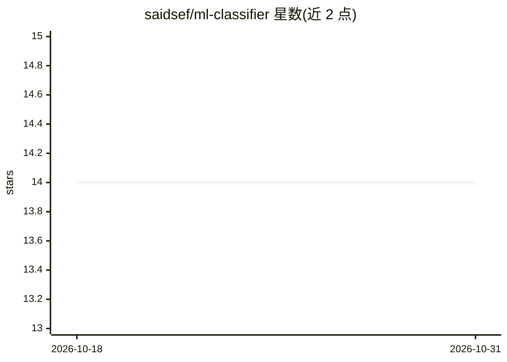

# saidsef/ml-classifier

⭐ 14 · Jupyter Notebook · MIT · 推送 2026-10-30 · [GitHub](https://github.com/saidsef/ml-classifier) · 个人维护

**基于 sklearn 的新闻文章分类服务：REST API 实时预测类别**

使用 scikit-learn 训练的新闻文章分类器：在 6000 篇文档、47 个类别的数据集上做预处理、描述性分析与多模型训练比较，用 VotingClassifier 软投票组合未拟合估计器，选出候选模型后封装为 REST API 服务，POST 文本即返回类别及概率得分。以 Docker 容器、uv 运行的 Python 应用和 Kubernetes 部署三种方式提供，附带 Jupyter Notebook 教程与 readthedocs 文档。要求 Python >= 3.13 与 uv。

## 筛选速览

| 维度 | 判定 | 备注 |
|---|---|---|
| AI 角色 | `ai-native` | 本体是模型或模型工具 |
| 许可风险 | `permissive` | MIT |
| 部署形态 | `self-host` | docker 或自建部署 |
| 模型依赖 | — | README 未给出锁定关系 |
| 硬件要求 | — | 无带数字的原话,不猜 |
| 安装摩擦 | `low` | 无编译、无系统依赖或容器化 |
| 成熟度 | — | 结构信号不足 |

## 能力要点

- 6000 文档、47 类别数据集上的 sklearn 多模型训练与比较
- VotingClassifier 软投票组合多个估计器
- REST API 返回类别与概率得分（POST /api/v1/news）
- 支持 Docker 容器与 Kubernetes kustomize 部署

## 适用场景

- 通过 REST API 对新闻文章做实时分类
- 学习 sklearn 建模流程与服务化部署
- 在 Kubernetes 集群中运行分类服务

## 场景标签

 · 领域:机器学习/文本分类

## 证据(README 行号)

> L3: Classify news articles into different categories using Machine Learning. The dataset consists of 6000 documents and 
> L43: - Once we have chosen the candidate model(s), we will use it to perform predictions and to create a simple web appl
> L83: The response names the category and its probability:

## 星数曲线

2026-10-18 14 → 2026-10-31 14（+0）

---
*卡片 v1 · prompt 1.4 · 生成 2026-10-31 · 置信度 high · 依据 README sha `6317d39e1670` · [字段定义](../../DATASET.md)*
