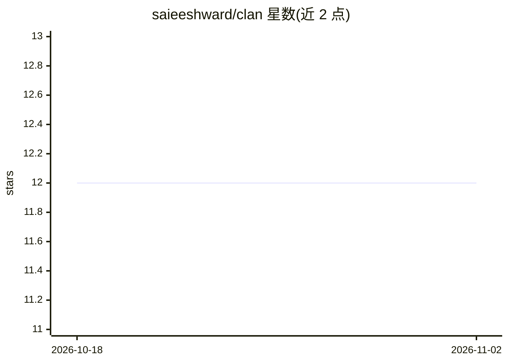

# saieeshward/clan

⭐ 12 · Rust · MPL-2.0 · 推送 2026-09-17 · [GitHub](https://github.com/saieeshward/clan) · [官网](https://github.com/saieeshward/clan) · 组织维护

**agent 间任务交接的开放文件格式（.clan），强制溯源与确定性并行合并**

面向多 agent 流水线的交接文件格式规范（MPL-2.0），非框架、非运行时。.clan 文件为标准 ZIP，内含任务规格、决策历史、输出 JSON Schema 与可渲染人类视图；Rust CLI/SDK 作为参考实现，在写入时强制 --agent/--action 溯源（缺失即拒绝），fork 出的并行 agent 写入独立命名空间，merge 为确定性机械合并、零 LLM token。另提供 Tauri 桌面查看器（点击编辑、人类编辑计入溯源链），任何语言可实现该格式。限制：短链路有格式开销；synthesis-hop 节省效果不稳定；溯源真实性依赖 agent 自述。

## 筛选速览

| 维度 | 判定 | 备注 |
|---|---|---|
| AI 角色 | `ai-ecosystem` | LLM/agent 周边工具 |
| 许可风险 | `permissive` | MPL-2.0 |
| 部署形态 | `desktop` | 安装包/桌面程序 |
| 模型依赖 | — | README 未给出锁定关系 |
| 硬件要求 | — | 无带数字的原话,不猜 |
| 安装摩擦 | `low` | 无编译、无系统依赖或容器化 |
| 成熟度 | — | 结构信号不足 |

## 能力要点

- 写入时强制溯源：无 --agent/--action 的变更被拒绝
- fork/merge 并行安全：命名空间隔离 + 确定性零 LLM 合并
- 冷启动恢复：新 agent 仅凭文件内嵌 spec 即可接续任务
- README 含基准测试与自述失败场景（Where CLAN loses）

## 适用场景

- 多 agent 流水线中跨团队/跨模型交接任务状态
- 并行 agent 各写分支后确定性合并并保留双方溯源
- 人类查看与编辑 agent 产出且编辑记录可追溯

## 场景标签

`多智能体` · 领域:Agent 开发

## 证据(README 行号)

> L9: > Not a framework. Not a runtime. A file format - where the hard parts are solved by design.
> L13: CLAN is a file format that fixes the artifact, not the runtime. A `.clan` file is a standard ZIP containing the tas
> L15: There's no CLAN runtime, no CLAN cloud. Any language can read and write the format. The Rust CLI and SDK are a refe

## 星数曲线

2026-10-18 12 → 2026-11-02 12（+0）

---
*卡片 v1 · prompt 1.4 · 生成 2026-11-01 · 置信度 high · 依据 README sha `07714cb7ef5d` · [字段定义](../../DATASET.md)*
